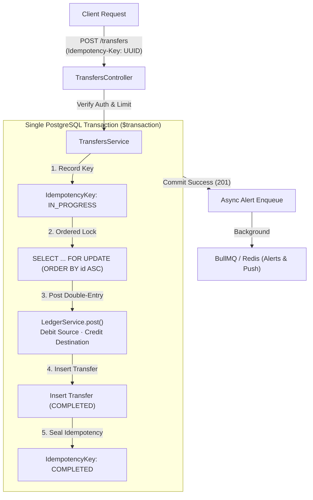
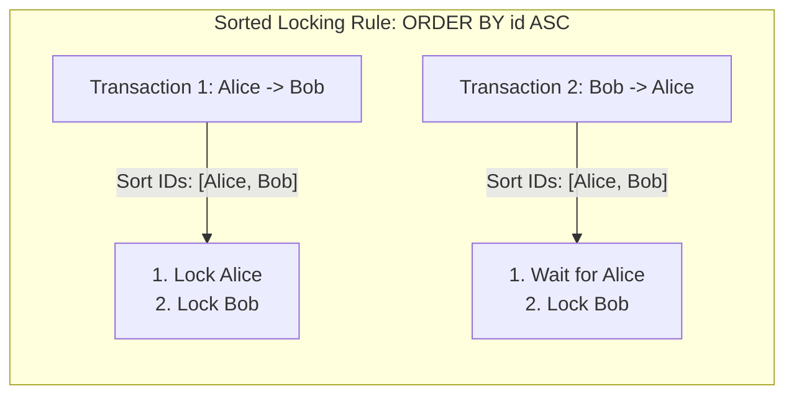
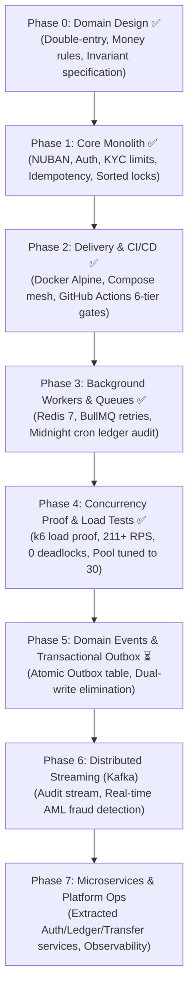

# 🏦 Banking API

> An enterprise-grade, commercial core banking engine engineered with **NestJS 12**, **Prisma 7**, **PostgreSQL 16**, and **Redis 7**. Built on **strict double-entry bookkeeping**, **deadlock-immune pessimistic row locking**, **two-phase idempotency**, and **asynchronous worker queues**.

[](https://github.com/devhenode/Banking-API/actions)
[](docs/TEST_RESULTS.md#1--unit-test-suite-verification-vitest)
[](docs/TEST_RESULTS.md#2--end-to-end-concurrency-stress-suite-vitest-e2e)
[](docs/BENCHMARKS.md)
[](#-empirical-concurrency--load-proof)
[](#-empirical-concurrency--load-proof)
[](package.json)
[](Dockerfile)

---

## 📑 Contents
- [✨ Core Capabilities](#-core-capabilities)
- [⚡ Empirical Concurrency & Load Proof](#-empirical-concurrency--load-proof)
- [🏗️ Architectural Foundations](#️-architectural-foundations)
- [🗺️ Engineering Roadmap](#️-engineering-roadmap)
- [🚀 Quickstart & Reproduction](#-quickstart--reproduction)
- [📚 Documentation Index](#-documentation-index)

---

## ✨ Core Capabilities

* **⚖️ Strict Double-Entry General Ledger:** Money exists only as immutable debit and credit lines ($\sum \text{Debits} - \sum \text{Credits} = 0$). PostgreSQL plpgsql triggers strictly forbid `UPDATE` and `DELETE` on all ledger tables.
* **🔒 Deadlock-Immune Concurrency Engine:** Uses lexicographically ordered pessimistic row locks (`ORDER BY id ASC FOR UPDATE`) to guarantee zero database deadlocks (`40P01`) under simultaneous high-frequency cross-transfers.
* **🔁 Two-Phase Idempotency Protection:** Enforces unique `Idempotency-Key` headers with SHA-256 payload hashing, caching completed results for deterministic re-play and blocking concurrent duplicate requests with `409 Conflict`.
* **🏧 Central Bank of Nigeria (CBN) NUBAN Compliance:** 10-digit account numbers generated via the official CBN MOD-10 check-digit algorithm with automated collision retry handling.
* **🪪 3-Tier KYC Progression & Spending Caps:** Automated tier verification (NIN → BVN + Proof of Address → Biometric Liveness) enforcing real-time daily spending limit ceilings (₦50,000 / ₦200,000 / ₦5,000,000).
* **📬 Decoupled Asynchronous Worker Queues:** Redis 7 + BullMQ queue workers dispatching OTPs and transaction alerts with exponential backoff retries (1s, 2s, 4s) outside the critical transaction path.
* **⏰ Autonomous Midnight Ledger Audit:** Automated cron service (`@nestjs/schedule`) executing daily at `00:00:00 UTC` to audit system-wide financial equilibrium.

---

## ⚡ Empirical Concurrency & Load Proof

How do we prove to stakeholders and regulators that this system will not deadlock or corrupt balances during a Black Friday flash sale? **We proved it with k6.**

### 📊 Benchmark Performance Summary

| Metric | Scenario A: Hot-Account (50 VUs) | Scenario B: Dispersed Before Tuning (100 VUs) | Scenario B: Dispersed After Tuning (100 VUs) | Impact |
| :--- | :--- | :--- | :--- | :--- |
| **Total Completed Transfers** | **5,532** | 4,128 | **7,397** | **+79.2% volume** |
| **Sustained Throughput** | **184.17 req/s** | 117.88 req/s | **211.34 req/s** | **+79.3% RPS** |
| **HTTP Failure Rate** | **0.00%** (0 errors) | 0.07% (3 timeouts) | **0.00%** (0 errors) | **100% Zero-Error SLA** |
| **Database Deadlocks (`40P01`)** | **0** | **0** | **0** | 🛡️ **Zero deadlocks** |
| **Median Latency (p50)** | **67.68 ms** | 300.19 ms | **346.75 ms** | ⚡ Sub-350ms |
| **95th Percentile (p95)** | **222.19 ms** | 2,350 ms | **483.66 ms** | **4.8x faster** |
| **99th Percentile (p99)** | **378.70 ms** | 5,530 ms | **552.52 ms** | **10.0x faster** |
| **Max Latency** | **526.59 ms** | 6,300 ms | **968.90 ms** | **Sub-second peak** |
| **Net Ledger Balance Drift** | **0 kobo** | **0 kobo** | **0 kobo** | ⚖️ **Perfect $\Delta = 0$** |

---

### 🔍 Verified Test Evidence Logs

<details>
<summary><b>1. 🎯 Hot-Account Contention Benchmark (50 Concurrent VUs Hammering 1 Account)</b></summary>

```text
     execution: local
        script: load-tests/hot-account.js
     scenarios: 50 max VUs for 30s over 3 stages

  █ THRESHOLDS 
    http_req_duration: ✓ 'p(95)<800' p(95)=222.19ms · ✓ 'p(99)<1500' p(99)=378.7ms
    http_req_failed:   ✓ 'rate<0.01' rate=0.00%

  █ TOTAL RESULTS 
    checks_total.......: 11064 (100.00% succeeded, 0 failed)
    ✓ status is 201
    ✓ has transfer id
    http_req_duration..: avg=84.05ms min=5.20ms med=67.68ms max=526.59ms p(90)=183.12ms p(95)=222.19ms
    http_req_failed....: 0.00% (0 out of 5532)
    http_reqs..........: 5532 (184.17 req/s)
```
</details>

<details>
<summary><b>2. 🚀 Dispersed High-Throughput Benchmark (100 Concurrent VUs Across 50 Accounts)</b></summary>

```text
     execution: local
        script: load-tests/dispersed-transfers.js
     scenarios: 100 max VUs for 35s over 4 stages

  █ THRESHOLDS 
    http_req_duration: ✓ 'p(95)<600' p(95)=483.66ms · ✓ 'p(99)<1200' p(99)=552.52ms
    http_req_failed:   ✓ 'rate<0.01' rate=0.00%

  █ TOTAL RESULTS 
    checks_total.......: 14794 (100.00% succeeded, 0 failed)
    ✓ status is 201
    ✓ has transfer id
    http_req_duration..: avg=310.14ms min=8.00ms med=346.75ms max=968.90ms p(90)=459.52ms p(95)=483.66ms
    http_req_failed....: 0.00% (0 out of 7397)
    http_reqs..........: 7397 (211.34 req/s)
```
</details>

<details open>
<summary><b>3. ⚖️ Post-Load Accounting Audit Verification (Zero Balance Drift)</b></summary>

```text
🔍 Running Post-Load Accounting Audit & Concurrency Verification...

📊 Merchant Account: 6121823541
📥 Completed Transfers Received: 5534 (5,532 contention + 2 baseline)
💰 Merchant Ledger Balance: 553400 kobo (₦5,534.00)
🎯 Expected Balance:         553400 kobo
✅ Merchant Balance Integrity: PERFECT (0 balance drift under load!)

⚖️  System-Wide Total Debits:  5,180,075,600 kobo
⚖️  System-Wide Total Credits: 5,180,075,600 kobo
⚖️  Net Ledger Drift:         0
✅ Double-Entry Invariant: SATISFIED (Debits === Credits)
```
</details>

<details>
<summary><b>4. 🧪 Unit & Concurrency E2E Test Suite Run</b></summary>

```text
Unit Tests:
 Test Files  18 passed (18)
      Tests  71 passed (71)
   Duration  2.17s

E2E Concurrency Stress Suite:
 ✓ test/concurrent-transfers.e2e-spec.ts (4 tests)
       ✓ should execute 20 concurrent cross-transfers (A->B and B->A) without deadlocks (40P01) or balance corruption
 Test Files  2 passed (2)
      Tests  6 passed (6)
```
</details>

*Full certified audit log available in [docs/TEST_RESULTS.md](docs/TEST_RESULTS.md).*

---

## 🏗️ Architectural Foundations

### 1. Money Movement Pipeline (Double-Entry Atomicity)

Every transfer is an atomic unit of work inside a single PostgreSQL `$transaction`:



### 2. The Narrow Corridor: Deadlock-Free Lexicographical Row Locking

When Alice transfers to Bob while Bob simultaneously transfers to Alice, unordered locks create a cycle where each transaction waits for the other. By sorting IDs lexicographically, transactions always acquire locks in the exact same sequence:



---

## 🗺️ Engineering Roadmap



| Phase | Focus Area | Status | Verified Invariants |
|:---:|---|:---:|---|
| **0** | **Domain Design** | ✅ Done | Minor-unit `BIGINT` money, double-entry chart of accounts, ADRs. |
| **1** | **Core Monolith** | ✅ Done | 10-digit CBN NUBAN, SHA-256 OTP auth, 3-tier KYC, 20 parallel cross-transfers deadlock-free. |
| **2** | **Delivery & CI/CD** | ✅ Done | Multi-stage Docker Alpine (`USER node`), 6-tier GitHub Actions quality gates. |
| **3** | **Workers & Queues** | ✅ Done | BullMQ + Redis 7 queue buffer, exponential backoff retries, midnight cron ledger audit. |
| **4** | **Concurrency & Load Tuning** | ✅ Done | k6 concurrency proof (184 RPS hot account, 211 RPS dispersed), pool tuned to 30, 0 drift. |
| **5** | **Domain Events & Outbox** | ⏳ Next | Atomic Transactional Outbox table, dual-write elimination, reliable CDC publisher. |
| **6** | **Distributed Streaming** | ⏳ Planned | Apache Kafka event-driven ledger stream, real-time AML fraud consumer. |
| **7** | **Microservices Architecture** | ⏳ Planned | Bounded context service extraction (Auth, Accounts, Ledger, Payments), OpenTelemetry tracing. |

---

## 🚀 Quickstart & Reproduction

### Prerequisites
* [Docker Desktop](https://www.docker.com/)
* [Node.js 22+](https://nodejs.org/)
* [k6](https://k6.io/) (`brew install k6`)

### 1. Launch Container Mesh
```bash
cp .env.example .env
docker compose up -d
```

### 2. Run Test Verification Suites
```bash
npm install
npm test            # 18 unit test suites (71 tests)
npm run test:e2e     # End-to-end concurrency stress suite
```

### 3. Reproduce Concurrency & Load Proof
```bash
# 1. Deterministically seed 1 Hot Merchant + 50 funded accounts with JWTs
npx tsx scripts/seed-load-test.ts

# 2. Run Hot-Account Row Contention Benchmark (50 VUs)
k6 run --summary-export load-tests/reports/hot-account-summary.json load-tests/hot-account.js

# 3. Run Dispersed High-Throughput Benchmark (100 VUs)
k6 run --summary-export load-tests/reports/dispersed-tuned-summary.json load-tests/dispersed-transfers.js

# 4. Audit ledger balance equilibrium (Asserts 0 balance drift)
npx tsx scripts/verify-contention.ts
```

### 4. Regenerate Evidence Logbook
```bash
npm run record:proof
```

---

## 📚 Documentation Index

* **[SPEC_OVERVIEW.md](docs/SPEC_OVERVIEW.md):** Spec-Driven Development master overview and traceability matrix.
* **[DESIGN.md](docs/DESIGN.md):** Architectural decision records (ADRs 01–32) and detailed domain model.
* **[BENCHMARKS.md](docs/BENCHMARKS.md):** Empirical k6 load testing report, latency percentiles, and database pool tuning.
* **[TEST_RESULTS.md](docs/TEST_RESULTS.md):** Certified evidence logbook containing real test outputs and audit stamps.
* **[padlock_and_prototype_framework.md](docs/padlock_and_prototype_framework.md):** The mental framework deconstructing commercial banking complexity into everyday intuition.

---

<p align="center">
  <b>Built with discipline. Verified with proof. Ready for production.</b>
</p>
