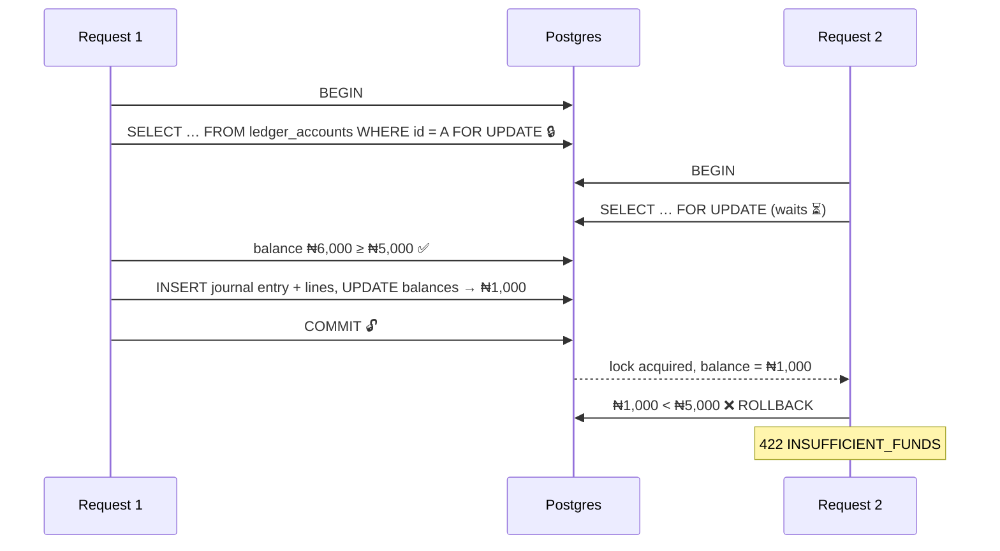
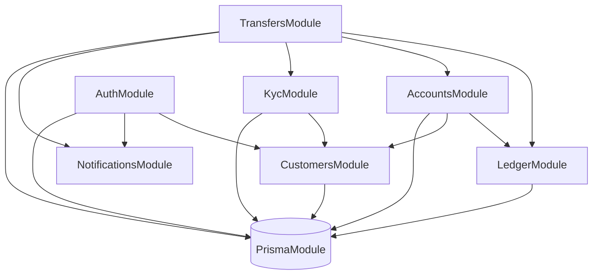
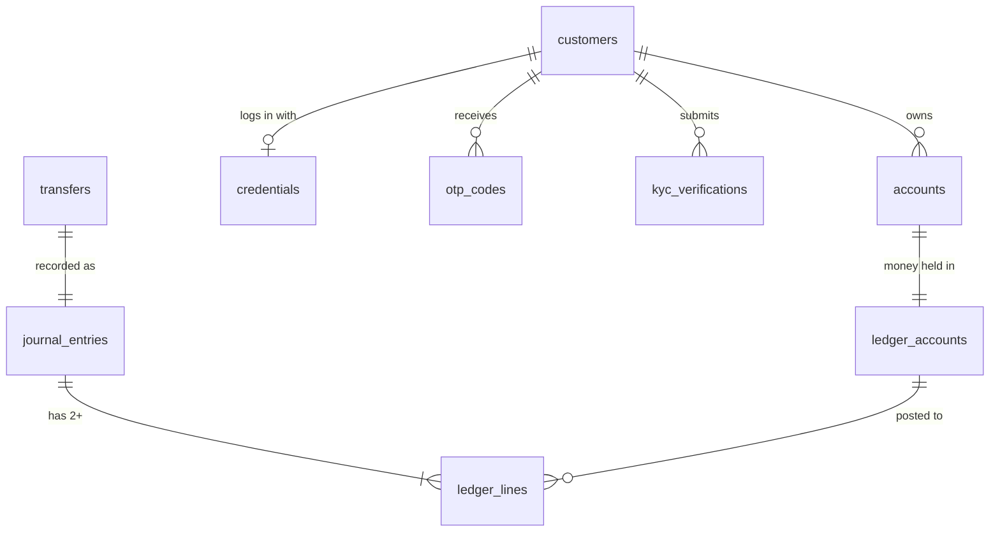

# 🏦 Banking API — Design Document

> **Status:** Living document · Phase 1 (Core Monolith)
> **Last updated:** 2026-10-15

This document records the architecture of the Banking API and the reasoning behind each decision. Every decision is also listed in the [Decision Log](#11--decision-log).

---

## 📑 Contents

1. [Purpose](#1--purpose)
2. [Money Rules](#2--money-rules)
3. [Ledger Model](#3--ledger-model)
4. [Idempotency](#4--idempotency)
5. [Concurrency](#5--concurrency)
6. [Phase 1 Scope](#6--phase-1-scope)
7. [Module Boundaries](#7--module-boundaries)
8. [Data Model](#8--data-model)
9. [Stack & Rationale](#9--stack--rationale)
10. [Engineering Standards](#10--engineering-standards)
11. [Decision Log](#11--decision-log)
12. [Open Questions](#12--open-questions)

---

## 1. 🎯 Purpose

A commercial banking API where customers **sign up with email or phone**, **verify with a 6-digit OTP**, **open accounts**, **move money** between accounts and **upgrade their KYC tier**. Every feature is testable through **Postman**, and the API is built to be deployed publicly.

### KYC tiers

| Tier | Requirements | Purpose |
|:---:|---|---|
| **1** | Verified email/phone + **NIN** | Basic account, low limits |
| **2** | Tier 1 + **BVN** + **proof of address** | Higher limits |
| **3** | Tier 1 & 2 + **liveness check** | Full limits |

Each tier carries a **daily transfer limit**.

### Account numbers

Accounts use the **10-digit NUBAN** format (9-digit serial + 1 check digit computed with the bank code), the Central Bank of Nigeria standard. Uniqueness is enforced by a database `UNIQUE` constraint.

---

## 2. 💰 Money Rules

| Rule | Decision |
|---|---|
| Storage type | **`BIGINT` in minor units** (₦150.75 → `15075` kobo) |
| Currency | Every amount is stored **with an ISO-4217 currency code** (`NGN`) |
| Floats | **Never** used for money, in the database or in code |
| API format | Amounts are sent and returned as **strings in minor units** (`"15075"`), because JavaScript `bigint` can't pass through `JSON.stringify` |

**Why not floats?** `0.1 + 0.2 === 0.30000000000000004`. Floating-point numbers can't represent most decimals exactly. Rounding only hides the error on screen while the stored value stays wrong.

**Why store the currency?** Currencies have different minor units: NGN and USD have 2 decimals, JPY has 0, KWD has 3.

---

## 3. 📒 Ledger Model

### Source of truth: ledger + cached balance

- **Ledger lines are the source of truth.** They are append-only: never updated, never deleted.
- Each ledger account carries a **cached `balance`**, updated **in the same database transaction** as the lines it summarises, so both commit or neither does.
- Mistakes are corrected with **reversal entries**, never by editing history.

### The golden rule

> **Every journal entry's total debits = total credits.**
> An entry that doesn't balance is rejected.

### Account types

| Account | Type | A debit… | A credit… |
|---|---|---|---|
| Customer account | Liability (money the bank owes) | ⬇️ decreases | ⬆️ increases |
| Fee income | Revenue | ⬇️ decreases | ⬆️ increases |
| Settlement / cash | Asset | ⬆️ increases | ⬇️ decreases |

### Worked example: A sends ₦5,000 to B, with a ₦10 fee

One journal entry, three lines:

| # | Account | Debit | Credit |
|:---:|---|---:|---:|
| 1 | Customer A | ₦5,010 | |
| 2 | Customer B | | ₦5,000 |
| 3 | Fee income | | ₦10 |
| | **Total** | **₦5,010** | **₦5,010** ✅ |

---

## 4. 🔁 Idempotency

**The problem:** a transfer succeeds, the response times out, and the client retries. Without protection, the money moves **twice**.

### Mechanism

The client sends a unique **`Idempotency-Key`** header (a UUID it generates) on every money-moving `POST`.

```http
POST /transfers
Idempotency-Key: 6f1c2a9e-4b7d-4e3a-9a1f-2c8d5e7b0f13
```

### What the server stores

| Field | Purpose |
|---|---|
| `key` + `customer_id` | Unique together, so one customer's keys can't clash with another's |
| `request_hash` | SHA-256 of method + path + body, to detect key reuse with a different body |
| `status` | `IN_PROGRESS` → `COMPLETED` |
| `response_code` + `response_body` | Replayed on retries |
| `expires_at` | Keys expire after 24 hours |

### Behaviour

| Situation | Response |
|---|---|
| New key | Process normally and save the response |
| Same key + same body, **completed** | **Replay** the saved response; nothing moves again |
| Same key, **still in progress** | **`409 Conflict`**: retry later |
| Same key + **different body** | **`422 Unprocessable Entity`**: key already used |
| Expired key | Treated as a new key |

> ⚠️ **Order matters:** the `IN_PROGRESS` row is inserted **before** any money moves. The unique constraint on (`customer_id`, `key`) makes the database reject a second concurrent insert, which is how the 409 case is detected.

The idempotency record is written **in the same transaction** as the transfer. If the transfer rolls back, so does the record, and the client can safely retry.

### Rejected alternatives

| Alternative | Problem |
|---|---|
| Duplicate detection (same sender, recipient and amount within 5 minutes) | Blocks legitimate repeat payments |
| Unique constraint on (from, to, amount) | A customer could only ever pay someone ₦5,000 once |
| Forbidding retries | Networks fail; clients **will** retry |

---

## 5. 🔒 Concurrency

**The problem:** A has **₦6,000**. Two **different** transfers of ₦5,000 (different idempotency keys) arrive at the same moment. Without locking, both read ₦6,000, both pass the check, and A ends at **−₦4,000**.

### Idempotency ≠ concurrency

| | **Idempotency** | **Concurrency** |
|---|---|---|
| Situation | The **same** request sent **twice** | **Two different** requests at the **same time** |
| Keys | Same `Idempotency-Key` | Different keys (`K1`, `K2`), both genuine |
| Analogy | The same cheque number presented twice | Two different cheques at two tellers at once |
| Fix | Store key + request hash | **Lock the balance row** |

With `K1` and `K2`, the idempotency table sees two new keys and lets both through. Only the row lock protects the balance. The system needs **both** protections.

### Decision: pessimistic row lock

Every posting runs inside **one database transaction**:



1. `BEGIN` the transaction.
2. **Lock the affected `ledger_accounts` rows** with `SELECT … FOR UPDATE`. Other transactions touching those rows wait.
3. Read the balance **after** taking the lock and check that it covers amount + fee.
4. Insert the journal entry and its lines (debits = credits).
5. Update the cached balances.
6. `COMMIT`, which releases the locks.

### What gets locked

- 🔒 Only the **specific `ledger_accounts` rows** involved: never the whole table.
- A second `SELECT … FOR UPDATE` on the same row **blocks** until the first transaction commits or rolls back.
- `SERIALIZABLE` isolation was considered. It doesn't wait: Postgres aborts one transaction with a serialization failure (`40001`), and the application must retry. Row locks keep the behaviour simpler and predictable.

### Deadlocks and lock ordering

A sends ₦5,000 to B **while** B sends ₦3,000 to A. If each transaction locks *sender first*:

| Time | Tx 1 (A → B) | Tx 2 (B → A) |
|:---:|---|---|
| t1 | 🔒 locks **A** | 🔒 locks **B** |
| t2 | ⏳ waits for **B** | ⏳ waits for **A** |
| t3 | 💀 **Deadlock**: Postgres detects it after ~1s and kills one (`40P01`) | |

**Rule:** accounts are always locked in the **same order, sorted by ledger account ID**, whatever the direction of the transfer. Both transactions then try the lower ID first, so one simply waits and no cycle can form.

> Prisma's query API can't express `FOR UPDATE`, so locking uses `$queryRaw` inside `prisma.$transaction(async (tx) => …)`.

---

## 6. 📦 Phase 1 Scope

### In scope

| Area | Includes |
|---|---|
| Customers & auth | Sign-up (email/phone), OTP verification, login (JWT), forgot password |
| Notifications | **Pluggable `NotificationSender`** interface: console sender in development, email sandbox later, swapped through dependency injection |
| KYC (mocked) | Tiers 1–3 with **daily transfer limits per tier**. NIN/BVN/liveness checks are **mocked**: any correctly formatted value passes |
| Accounts | Account opening, **10-digit NUBAN** account numbers, status |
| Ledger & transfers | Double-entry ledger, deposits, internal transfers, transaction history, idempotency |
| Quality | Validation, error handling, automated tests (including a concurrent-transfer test), Postman collection |

### Deferred

| Deferred | Until | Why |
|---|---|---|
| Background workers | Phase 3 | Phase 1 runs everything inside requests |
| Kafka / events | Phases 5–6 | No consumers yet; a correct core comes first |
| Microservices | Phase 7 | Boundaries are proven inside the monolith first |
| Real KYC providers (NIN/BVN/liveness) | Later phase | Needs third-party sandboxes; mocked in Phase 1 |
| External bank transfers | Later phase | Needs a payment provider; internal transfers first |

---

## 7. 🧩 Module Boundaries

### Rules

1. **Every table has exactly one owner module.** Only the owner reads from or writes to it.
2. Other modules go through the owner's **exported service**, never `prisma.<otherTable>` directly.
3. Dependencies point **one way**. No cycles.
4. **Policy lives at the top, invariants at the bottom.** Use-case modules (Transfers) apply business policy such as KYC limits and ownership checks. The Ledger enforces only accounting invariants: balanced entries, no overdraft, locking.
5. Cross-cutting concerns (validation, errors, idempotency, logging) live in `common/`, not in domain modules.

### Modules

| Module | Responsibility | Owns (tables) | Exports |
|---|---|---|---|
| `AuthModule` | Sign-up, login (JWT), OTP, forgot password | `credentials`, `otp_codes`, `refresh_tokens` | `AuthService` |
| `CustomersModule` | Customer profile | `customers` | `CustomersService` |
| `KycModule` | Tiers, mocked NIN/BVN/liveness, **limit policy** | `kyc_verifications` | `KycService` |
| `AccountsModule` | Account opening, NUBAN generation, status, **balance & history endpoints** | `accounts` | `AccountsService` |
| `LedgerModule` | **The only writer of money.** Postings, the debit = credit rule, balances, row locks. **No controller.** | `ledger_accounts`, `journal_entries`, `ledger_lines` | `LedgerService` only |
| `TransfersModule` | Use-case orchestration: idempotency → ownership → limits → post to the ledger | `transfers` | — |
| `NotificationsModule` | `NotificationSender` interface + console / email implementations | — | `NotificationsService` |
| `PrismaModule` *(infrastructure)* | Database client and lifecycle. **Not global**: imported explicitly by every module that owns tables. | — | `PrismaService` |
| `common/` *(not a module)* | Idempotency interceptor, exception filters, validation pipes | `idempotency_keys` | — |

`AppModule` only **composes** modules. It never registers domain controllers or services itself.

### One transaction across modules

A transfer must save the idempotency record, the transfer row and the ledger postings **atomically**, but those tables have different owners. The orchestrating service opens **one** transaction and **passes the transaction client** (`tx`) into each owner's service:

```ts
await prisma.$transaction(async (tx) => {
  await idempotency.start(tx, …);   // writes idempotency_keys
  await transfers.create(tx, …);    // writes transfers
  await ledger.post(tx, …);         // writes ledger tables
});
```

Each service still writes only its own tables, but all writes commit or roll back together. Events or message brokers are **not** used for this: they can't provide atomicity and would replace a guarantee with eventual consistency.

### Reads go through the owner too

Balance and transaction history are served by `AccountsController`. `AccountsService` calls `LedgerService.getBalance()` and `LedgerService.getHistory()`; it never queries ledger tables. This keeps the Ledger free to change its schema, and extractable as a service in Phase 7.

### Dependency direction



`LedgerModule` depends on **no other domain module**. It knows about money, not about people, OTPs or tiers.

---

## 8. 🗄️ Data Model

### Identifiers

- **Primary keys are UUID v7** (RFC 9562), stored as native Postgres `uuid`. They are unguessable, can be generated anywhere, and are **time-ordered**, so B-tree indexes stay compact.
- **NUBAN account numbers are a separate `UNIQUE` business key** (`CHAR(10)`), never the primary key.

| Rejected | Problem |
|---|---|
| Auto-increment IDs | `/accounts/42` invites guessing other IDs (IDOR attacks) and leaks business volume |
| UUID v4 | Random order scatters inserts across the index, slowing writes at scale |
| NUBAN as the primary key | Business identifiers can change (re-numbering, migrations); keys must never change |

### Column conventions

| Convention | Rule |
|---|---|
| Naming | Prisma models use camelCase; Postgres tables and columns use **snake_case** via `@map` / `@@map` |
| Timestamps | Always **`timestamptz(3)`**: an exact instant, stored as UTC. Daily limits, cut-offs and audit trails stay unambiguous across time zones. |
| Fixed-length codes | `CHAR(n)` so the database rejects wrong lengths (`account_number CHAR(10)`, `currency CHAR(3)`) |
| Format checks | `CHECK` constraints in migration SQL as a backstop, e.g. `account_number ~ '^[0-9]{10}$'` |
| Foreign keys | Always **indexed** (Postgres doesn't index them automatically) |
| Deletes | Customers and accounts are **closed**, never deleted |

### Enumerations

| Enum | Values |
|---|---|
| `CustomerStatus` | `PENDING_VERIFICATION` · `ACTIVE` · `SUSPENDED` · `CLOSED` |
| `AccountStatus` | `ACTIVE` · `SUSPENDED` · `CLOSED` |
| `AccountType` | `SAVINGS` · `CURRENT` |

### Ledger structure: journal + lines

- **`journal_entries`**: one row per financial event (a transfer, a fee, a reversal).
- **`ledger_lines`**: two or more rows per entry, each with a ledger account, a `direction` (`DEBIT` / `CREDIT`) and a **positive** `BIGINT` amount (`CHECK (amount > 0)`).
- All lines in one entry share the **same currency**, and **Σ debits = Σ credits** is verified in `LedgerService` before commit.

A single `transactions` table (from, to, amount) was rejected: it can't represent entries with 3+ legs (fees) or internal accounts cleanly.

### Ledger accounts (chart of accounts)

Not every account money sits in belongs to a customer (e.g. **Fee income**, **Settlement**). The Ledger keeps its own `ledger_accounts` table, which also holds the cached balance:

| Column | Notes |
|---|---|
| `id` | UUID v7 |
| `account_id` | Links to `accounts.id` for customer accounts; `NULL` for internal accounts |
| `code` | e.g. `FEE_INCOME`, `SETTLEMENT_NGN`, for internal accounts |
| `type` | `ASSET` · `LIABILITY` · `REVENUE` · `EXPENSE` · `EQUITY` |
| `currency` | ISO-4217, e.g. `NGN` |
| `balance` | `BIGINT` minor units, updated in the same transaction as the lines |

The `accounts` table therefore has **no balance column**.

### Immutability

Ledger tables are **append-only, enforced in Postgres**: a trigger rejects any `UPDATE` or `DELETE` on `journal_entries` and `ledger_lines`. Application code never edits them either, but the database is the last line of defence against bugs, scripts and manual SQL sessions. Corrections are new **reversal** entries.

### Secrets & OTPs

Password hashes live in a separate **`credentials`** table owned by `AuthModule`, never on `customers`. Many modules, queries and exports read customer data; keeping secrets elsewhere limits the blast radius of any leak or over-broad query.

One-time passcodes live in **`otp_codes`** with their code hashed (`code_hash`), an expiration timestamp (`expires_at`), an attempt counter (`attempts`), and an enum purpose (`REGISTRATION`, `PASSWORD_RESET`, `LOGIN`). Raw OTPs are never stored in plaintext.

### Cross-module foreign keys

Foreign keys across module boundaries (e.g. `accounts.customer_id → customers.id`) are **allowed in the monolith**, where one database gives referential integrity for free. When modules become separate services (Phase 7), these become plain ID references, validated through the owner's API or events.

### Entity overview



---

## 9. 🧱 Stack & Rationale

| Layer | Choice |
|---|---|
| Language | TypeScript (strict mode) |
| Framework | **NestJS 12** |
| Data layer | **Prisma 7** with the `pg` driver adapter, plus raw SQL for row locks |
| Database | **PostgreSQL 16** (Alpine image) |
| Configuration | `@nestjs/config`, loaded once and fail-fast on missing values |
| Testing | Vitest, Postman |

### Why NestJS?

- **Modules map to bounded contexts.** Accounts, Ledger and Auth are separate modules inside the monolith; when services are extracted in Phase 7, each module becomes a service.
- **Built-in microservice transports**, including Kafka, support Phases 6–7.
- **Dependency injection** makes services testable: real dependencies are swapped for fakes in tests.
- An enterprise structure familiar from Java (Spring) and C# (.NET), widely used by fintech teams.

### Known trade-offs

- Prisma can't express row locks through its query API → raw SQL for that one critical path.
- Prisma returns `BIGINT` as `bigint` → amounts are serialised as strings.
- NestJS has a learning curve (modules, providers, guards, pipes, interceptors).

---

## 10. 🛠️ Engineering Standards

| Area | Standard |
|---|---|
| Dependency versions | Pinned **exactly** (`--save-exact`); no pre-release (`-rc`, `-beta`, `-dev`) packages; companion packages kept on the same version (e.g. `prisma` + `@prisma/client`) |
| Lockfile | `package-lock.json` is committed; CI installs with `npm ci` |
| Install scripts | Blocked by default; only reviewed packages are allow-listed |
| Imports | Every imported package is declared in `package.json` (no phantom dependencies) |
| Secrets | Only in environment variables; `.env` is never committed; `.env.example` documents every key |
| Generated code | The Prisma client (`src/generated/`) is generated, never committed |
| Code generation | No CRUD generators (`nest g resource`): every endpoint is added deliberately, and money records have no update or delete endpoints |
| Migrations | SQL is generated with `--create-only`, reviewed, then applied. Applied migrations are never edited. |
| Commits | Conventional Commits (`feat:`, `fix:`, `chore:`, `refactor:`, `docs:`, `test:`) |
| Quality gate | `npm run lint`, `npm run build` and `npm test` pass before every commit |

---

## 11. 📋 Decision Log

| ID | Decision | Section |
|:---:|---|:---:|
| ADR-01 | Money is `BIGINT` minor units with an ISO-4217 currency; never floats | [2](#2--money-rules) |
| ADR-02 | Ledger lines are the source of truth; balances are cached in the same transaction | [3](#3--ledger-model) |
| ADR-03 | Double-entry: every journal entry balances | [3](#3--ledger-model) |
| ADR-04 | `Idempotency-Key` header with request hash; 409 in progress, 422 on mismatch | [4](#4--idempotency) |
| ADR-05 | Pessimistic row locks on `ledger_accounts`, acquired in ID order | [5](#5--concurrency) |
| ADR-06 | NUBAN 10-digit account numbers | [1](#1--purpose) |
| ADR-07 | Pluggable `NotificationSender` for OTPs | [6](#6--phase-1-scope) |
| ADR-08 | KYC tiers with daily limits; verification mocked in Phase 1 | [6](#6--phase-1-scope) |
| ADR-09 | One owner per table, for reads and writes | [7](#7--module-boundaries) |
| ADR-10 | Balance lives in the Ledger's `ledger_accounts`, not on `accounts` | [8](#8--data-model) |
| ADR-11 | Cross-module atomicity by passing the transaction client | [7](#7--module-boundaries) |
| ADR-12 | Policy checks in use-case modules; accounting invariants in the Ledger | [7](#7--module-boundaries) |
| ADR-13 | Ledger has no controller; `AccountsController` serves balance and history | [7](#7--module-boundaries) |
| ADR-14 | `LedgerModule` exports only `LedgerService` | [7](#7--module-boundaries) |
| ADR-15 | `PrismaModule` is imported explicitly, not global | [7](#7--module-boundaries) |
| ADR-16 | UUID v7 primary keys; NUBAN as a separate unique business key | [8](#8--data-model) |
| ADR-17 | Journal + lines ledger structure with a chart of accounts | [8](#8--data-model) |
| ADR-18 | Ledger tables are append-only, enforced by a Postgres trigger | [8](#8--data-model) |
| ADR-19 | Password hashes in a separate `credentials` table | [8](#8--data-model) |
| ADR-20 | Cross-module foreign keys allowed in the monolith only | [8](#8--data-model) |
| ADR-21 | All timestamps are `timestamptz` | [8](#8--data-model) |
| ADR-22 | Database-level `CHECK` constraints back up application validation | [8](#8--data-model) |
| ADR-23 | OTP codes stored hashed with expiration, attempt limit, and purpose enum | [8](#8--data-model) |

---

## 12. ❓ Open Questions

| # | Question | Notes |
|:---:|---|---|
| 1 | How are NUBAN serials generated? | A database sequence + check digit, or random + retry on collision |
| 2 | What are the daily limits per tier? | e.g. Tier 1 ₦50k, Tier 2 ₦200k, Tier 3 ₦5m |
| 3 | Pessimistic locks vs optimistic locking vs conditional `UPDATE` | Pessimistic for now; revisit under load testing in Phase 4 |
| 4 | Should accounts support "Post No Debit" (PND)? | Incoming money allowed, outgoing blocked; common during fraud or KYC reviews |
