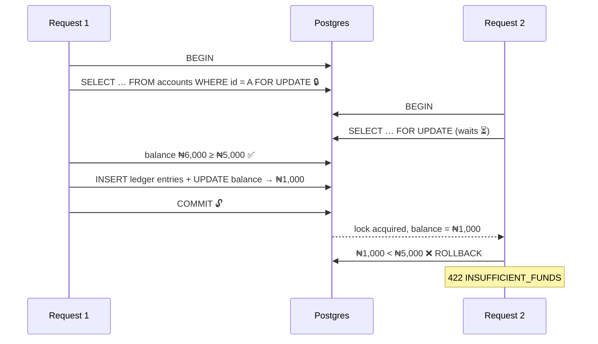
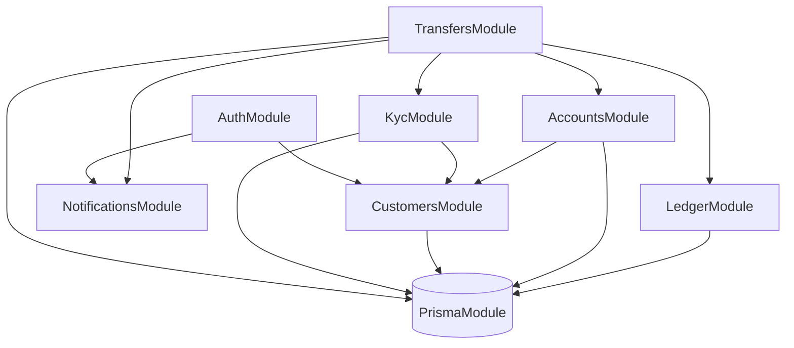
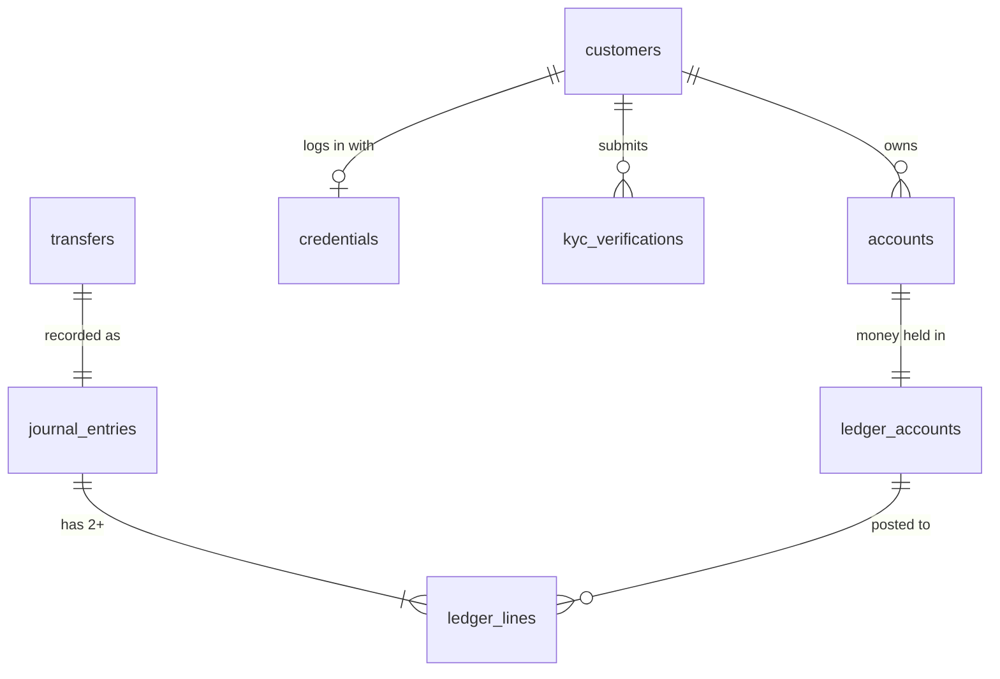

# 🏦 Banking API — Design Document

> **Status:** Phase 0 · Domain Design  
> **Type:** Architecture Decision Record (living document)  
> **Last updated:** 2026-10-15

**Legend:** ✅ Decided · 🟡 Proposed (needs confirmation) · ❓ Open question

---

## 📑 Contents

1. [Purpose](#1--purpose)
2. [Money Rules](#2--money-rules)
3. [Ledger Model](#3--ledger-model)
4. [Idempotency](#4--idempotency)
5. [Concurrency](#5--concurrency)
6. [Phase 1 Scope](#6--phase-1-scope)
7. [Module Boundaries](#7--module-boundaries)
8. [Data Model](#8--data-model)
9. [Stack & Rationale](#9--stack--rationale)
10. [Open Questions](#10--open-questions)

---

## 1. 🎯 Purpose

A commercial banking API that lets customers **sign up with email or phone**, **verify with a 6-digit OTP**, **open accounts** with unique account numbers, **move money** between accounts, and **upgrade KYC tiers**. Every feature can be tested through **Postman** and the API can be deployed publicly.

### KYC tiers

| Tier | Requirements | Purpose |
|:---:|---|---|
| **1** | Verified email/phone + **NIN** | Basic account, low limits |
| **2** | Tier 1 + **BVN** + **proof of address** | Higher limits |
| **3** | Tier 1 & 2 + **liveness check** | Full limits |

Also in the feature set: account recovery (**forgot password**), transfers, and other standard commercial-banking operations, added in phases.

> ✅ **Account numbers:** **10-digit NUBAN** format (9-digit serial + 1 check digit computed with the bank code). Uniqueness is enforced by a database `UNIQUE` constraint.

---

## 2. 💰 Money Rules

| Rule | Decision | Status |
|---|---|:---:|
| Storage type | **`BIGINT` in minor units** (₦150.75 → `15075` kobo) | ✅ |
| Currency | Every amount is stored **with an ISO-4217 currency code** (`NGN`) | ✅ |
| Floats | **Never** used for money, in the database or in code | ✅ |
| API format | Amounts are sent and returned as **strings in minor units** (`"15075"`), because JavaScript `bigint` can't go through `JSON.stringify` | 🟡 |

**Why not floats?** `0.1 + 0.2 === 0.30000000000000004`. Floats can't represent most decimals exactly, and rounding only hides the error on screen.

**Why store the currency?** Currencies have different minor units: NGN/USD = 2 decimals, JPY = 0, KWD = 3.

---

## 3. 📒 Ledger Model

### Source of truth: ledger + cached balance ✅

- **Ledger entries are the source of truth.** They're append-only and never updated or deleted.
- Each account has a **cached `balance` column**, updated **in the same database transaction** as the ledger entries, so both commit or neither does.
- Mistakes are corrected with **reversal entries**, never by editing history.

### The golden rule ✅

> **Every transaction's total debits = total credits.**  
> If they don't balance, the transaction is rejected.

### Account types

| Account | Type | A debit… | A credit… |
|---|---|---|---|
| Customer account | Liability (money the bank owes) | ⬇️ decreases | ⬆️ increases |
| Fee income | Revenue | ⬇️ decreases | ⬆️ increases |
| Settlement / cash | Asset | ⬆️ increases | ⬇️ decreases |

### Worked example: A sends ₦5,000 to B, ₦10 fee

| # | Account | Debit | Credit |
|:---:|---|---:|---:|
| 1 | Customer A | ₦5,010 | |
| 2 | Customer B | | ₦5,000 |
| 3 | Fee income | | ₦10 |
| | **Total** | **₦5,010** | **₦5,010** ✅ |

---

## 4. 🔁 Idempotency

**The problem:** a transfer succeeds, the response times out, and the client retries. Without protection, the money moves **twice**.

### The mechanism ✅

The client sends a unique **`Idempotency-Key`** header (a UUID it generates) on every money-moving `POST`.

```http
POST /transfers
Idempotency-Key: 6f1c2a9e-4b7d-4e3a-9a1f-2c8d5e7b0f13
```

### What the server stores

| Field | Purpose |
|---|---|
| `key` + `customer_id` | Unique together, so one customer's keys can't clash with another's |
| `request_hash` | SHA-256 of method + path + body, to detect key reuse with a different body |
| `status` | `IN_PROGRESS` → `COMPLETED` |
| `response_code` + `response_body` | Replayed on retries |
| `expires_at` | Keys expire after 24h |

### Behaviour ✅

| Situation | Response |
|---|---|
| New key | Process normally and save the response |
| Same key + same body, **completed** | **Replay** the saved response; nothing moves again |
| Same key, **still in progress** | **`409 Conflict`**: retry later |
| Same key + **different body** | **`422 Unprocessable Entity`**: key already used |
| Expired key | Treated as a new key |

> ⚠️ **Order matters:** the `IN_PROGRESS` row is inserted **before** any money moves, and the unique constraint on (`customer_id`, `key`) makes the database reject a second insert. That's how the 409 case can be detected at all.

### Why not the alternatives?

- ❌ *Duplicate detection (same sender, recipient and amount within 5 minutes):* blocks legitimate repeat payments.
- ❌ *Unique constraint on (from, to, amount):* you could only ever pay someone ₦5,000 once.
- ❌ *Forbid retries:* networks fail, and clients **will** retry.

---

## 5. 🔒 Concurrency

**The problem:** A has **₦6,000**. Two **different** transfers of ₦5,000 (different idempotency keys) arrive at the same moment. Idempotency doesn't help here, because these are two genuine requests. Without locking, both read ₦6,000, both pass the check, and A ends at **−₦4,000**.

### Idempotency ≠ concurrency

| | **Idempotency** | **Concurrency** |
|---|---|---|
| Situation | The **same** request sent **twice** | **Two different** requests at the **same time** |
| Keys | Same `Idempotency-Key` | Different keys (`K1`, `K2`), both genuine |
| Bank analogy | The same cheque number presented twice | Two different cheques at two tellers at once |
| Fix | Store key + request hash | **Lock the account row** |

> With `K1` and `K2`, the idempotency table sees two **new** keys and lets **both** through. Only the row lock protects the balance.

### Decision: pessimistic row lock ✅

Every transfer runs inside **one database transaction**:



1. `BEGIN` the transaction.
2. **Lock the sender's row** with `SELECT … FOR UPDATE`. Other transactions wait.
3. Read the balance **after** taking the lock and check that it covers amount + fee.
4. Insert the ledger entries (debits = credits).
5. Update the cached balances.
6. `COMMIT`, which releases the lock.

### What gets locked

- 🔒 The **sender's row in the `accounts` table**: one row, not the whole table and not the ledger.
- Waiting = a second `SELECT … FOR UPDATE` on the same row **blocks** until the first transaction commits or rolls back.
- *Alternative:* `SERIALIZABLE` isolation **doesn't wait**. Postgres aborts one transaction with a serialization failure (`40001`), and the app must **retry** it.

### Deadlocks & the lock-ordering rule ✅

A sends ₦5,000 to B **while** B sends ₦3,000 to A, and each transaction locks *sender first*:

| Time | Tx 1 (A → B) | Tx 2 (B → A) |
|:---:|---|---|
| t1 | 🔒 locks **A** | 🔒 locks **B** |
| t2 | ⏳ waits for **B** | ⏳ waits for **A** |
| t3 | 💀 **Deadlock**: each waits on the other forever. Postgres detects it after ~1s and kills one (`40P01`). | |

**Rule:** always lock accounts in the **same order, sorted by account ID**, whatever the direction of the transfer. Both transactions then try to lock the lower ID first, so one simply waits and no cycle can form.

> 📝 Prisma's query API can't express `FOR UPDATE`, so this step uses `$queryRaw` inside `prisma.$transaction(async (tx) => …)`.

---

## 6. 📦 Phase 1 Scope

### ✅ In

| Area | Includes |
|---|---|
| Customers & auth | Sign-up (email/phone), OTP verification, login (JWT), forgot password |
| Notifications | **Pluggable `NotificationSender`** interface: console sender in dev, email sandbox later, swapped via dependency injection |
| KYC (mocked) | Tiers 1–3 with **daily transfer limits per tier**. NIN/BVN/liveness checks are **mocked**: any correctly formatted value passes |
| Accounts | Account opening, **10-digit NUBAN** account numbers, status |
| Ledger & transfers | Double-entry ledger, deposits, internal transfers, transaction history, idempotency |
| Quality | Validation, error handling, automated tests, Postman collection |

### 🚫 Out (deliberately deferred)

| Deferred | Until | Why |
|---|---|---|
| Kafka / events | Phase 5–6 | No consumers yet; a correct core comes first |
| Background workers | Phase 3 | Phase 1 runs everything inside requests |
| Microservices | Phase 7 | Boundaries are proven inside the monolith first |
| Real KYC providers (NIN/BVN/liveness) | Later phase | Needs third-party sandboxes; mocked in Phase 1 |
| External bank transfers | 🟡 TBD | Needs a payment provider; internal transfers first |

---

## 7. 🧩 Module Boundaries

> 🟡 **Draft.** Proposed after review; waiting on decisions M1–M3.

### Rules ✅

1. **Every table has exactly one owner module.** Only the owner writes to it.
2. Other modules go through the owner's **exported service**, never `prisma.<otherTable>` directly.
3. Dependencies point **one way**. No cycles.
4. Cross-cutting concerns (validation, errors, idempotency, logging) live in `common/`, not in domain modules.

### Proposed modules

| Module | Responsibility | Owns (tables) |
|---|---|---|
| `AuthModule` | Sign-up, login (JWT), OTP, forgot password | `credentials`, `otp_codes`, `refresh_tokens` |
| `CustomersModule` | Customer profile | `customers` |
| `KycModule` | Tiers, mocked NIN/BVN/liveness, **limit policy** | `kyc_verifications` |
| `AccountsModule` | Account opening, NUBAN generation, status (**no balance**) | `accounts` |
| `LedgerModule` | **The only writer of money.** Postings, the debit = credit rule, balances, row locks | `ledger_accounts`, `journal_entries`, `ledger_lines` |
| `TransfersModule` | Use-case orchestration: validate → limits → post to the ledger | `transfers` |
| `NotificationsModule` | `NotificationSender` interface + console / email implementations | — |
| `PrismaModule` *(infrastructure)* | Database client, transaction helper | — |
| `common/` *(not a module)* | Idempotency interceptor, exception filters, validation pipes | `idempotency_keys` |

### Decisions

| # | Decision | Status |
|:---:|---|:---:|
| M1 | The **balance lives in a Ledger-owned table** (`ledger_accounts`). `accounts` holds customer-facing metadata only: number, status, customer. | ✅ |
| M2 | Several modules share **one DB transaction** by passing the transaction client (`tx`) between services | 🟡 |
| M3 | **Policy checks** (KYC limits, ownership) live in the use-case module (`TransfersModule`). The Ledger only records money. | 🟡 |
| G1 | **Ledger has no controller.** Balance and history are served by `AccountsController`, which calls `LedgerService` read methods (`getBalance`, `getHistory`). Reads go through the owner too. | ✅ |
| G2 | `LedgerModule` **exports only `LedgerService`**: its public methods are the only way in, and no other module touches ledger tables. | ✅ |
| P1 | `PrismaModule` is **not global**. Each module that owns tables imports it explicitly, so database access is visible in code review. | ✅ |

### Dependency direction



> `LedgerModule` depends on **no other domain module**. It knows about money, not about people, OTPs or tiers.

---

## 8. 🗄️ Data Model

### Decisions

| # | Decision | Status |
|:---:|---|:---:|
| S1 | **Primary keys are UUID v7** (RFC 9562): unguessable, generated anywhere, **time-ordered** so B-tree indexes stay efficient. **NUBAN is a separate `UNIQUE` business key**, never the primary key. | ✅ |
| S2 | **Journal + lines**: one `journal_entries` row per financial event, plus 2+ `ledger_lines` rows that must balance. | ✅ |
| S3 | **Append-only, enforced in Postgres**: a trigger rejects any `UPDATE` or `DELETE` on `journal_entries` and `ledger_lines`. Corrections are new **reversal** entries. | ✅ |
| S4 | **Password hashes live in `credentials`** (owned by `AuthModule`), never on `customers`. Many modules, queries and exports read customer data; keeping secrets elsewhere limits the blast radius of a leak. | ✅ |
| S5 | **Cross-module foreign keys are allowed in the monolith** (one database, integrity for free). In Phase 7 they become plain ID references, validated through the owner's API or events. | ✅ |
| S6 | **All timestamps are `timestamptz`**: exact instants (stored as UTC), so cut-offs, daily limits and audit trails are unambiguous across time zones. | ✅ |
| S7 | **Account number format is also checked in the database**: `CHECK (account_number ~ '^[0-9]{10}$')` | 🟡 |

### Why not the alternatives?

| Rejected | Problem |
|---|---|
| Auto-increment IDs | `/accounts/42` invites guessing other IDs (IDOR attacks) and leaks business volume |
| UUID v4 | Random order scatters inserts across the index, so writes slow down at scale |
| NUBAN as the primary key | Business identifiers can change (re-numbering, migrations); keys must never change |
| One `transactions` table (from, to, amount) | Can't represent 3+ legs (the fee) or internal accounts cleanly |
| Soft delete / updatable ledger | A ledger you can edit can't be trusted or audited |
| App-code-only immutability | One bug or one manual SQL session can rewrite history; the database is the last line of defence |

### Ledger accounts (the chart of accounts)

Not every ledger account belongs to a customer, e.g. **Fee income** and **Settlement**. So the Ledger keeps its own `ledger_accounts` table:

| Column | Notes |
|---|---|
| `id` | UUID v7 |
| `account_id` | Links to `accounts.id` for customer accounts; `NULL` for internal accounts |
| `code` | e.g. `FEE_INCOME`, `SETTLEMENT_NGN`, for internal accounts |
| `type` | `ASSET` · `LIABILITY` · `REVENUE` · `EXPENSE` · `EQUITY` |
| `currency` | ISO-4217, e.g. `NGN` |
| `balance` | `BIGINT` minor units: the cached balance, updated in the same transaction as the lines |

### Entity overview



### Ledger line rules

- `amount` is a **positive** `BIGINT` (`CHECK (amount > 0)`) with a separate `direction`: `DEBIT` or `CREDIT`
- Each line carries a `currency`, and every line in one entry uses the **same** currency
- **Σ debits = Σ credits** per journal entry, checked in `LedgerService` before commit

---

## 9. 🧱 Stack & Rationale

| Layer | Choice | Status |
|---|---|:---:|
| Language | TypeScript | ✅ |
| Framework | **NestJS** | ✅ |
| Data layer | **Prisma** (+ raw SQL for row locks) | ✅ |
| Database | PostgreSQL | ✅ |
| API testing | Postman | ✅ |

### Why NestJS?

- **Familiar enterprise structure.** Dependency injection and decorators work like Java (Spring) and C# (.NET) annotations and attributes. Fintech teams use it widely.
- **Testability.** Dependency injection makes it easy to swap real services for mocks in tests.
- 🟡 **Roadmap fit** *(to be confirmed in your own words)*: NestJS **modules** map to future services, and its built-in **microservice transports** (including Kafka) support Phases 6–7.

### Known trade-offs

- Prisma can't do row locks through its query API → raw SQL for that one critical path.
- Prisma returns `BIGINT` as `bigint` → amounts are serialised as strings.
- NestJS has a learning curve (modules, providers, guards, pipes, interceptors).

---

## 10. ❓ Open Questions

| # | Question | Notes |
|:---:|---|---|
| 1 | **How are NUBAN serials generated?** | A database sequence + check digit, or random + retry on collision? |
| 2 | **What are the daily limits per tier?** | e.g. Tier 1 ₦50k, Tier 2 ₦200k, Tier 3 ₦5m |
| 3 | **Pessimistic lock vs optimistic locking vs conditional `UPDATE`** | Pessimistic chosen for now; revisit under load testing in Phase 4 |
