# 🏦 Banking API — Design Document

> **Status:** Living document · Phase 4 (High-Throughput Concurrency, Load Proof & Database Tuning)
> **Last updated:** 2026-10-21

This document records the architecture of the Banking API and the reasoning behind each decision. Every decision is also listed in the [Decision Log](#14--decision-log).

---

## 📑 Contents

1. [Purpose](#1--purpose)
2. [Money Rules](#2--money-rules)
3. [Ledger Model](#3--ledger-model)
4. [Idempotency](#4--idempotency)
5. [Concurrency](#5--concurrency)
6. [Phase 1 Scope](#6--phase-1-scope)
7. [Module Boundaries](#7--module-boundaries)
8. [Data Model](#8--data-model)
9. [Stack & Rationale](#9--stack--rationale)
10. [Engineering Standards](#10--engineering-standards)
11. [Delivery & Containerization Architecture (Phase 2)](#11--delivery--containerization-architecture-phase-2)
12. [Asynchronous Queues & Background Processing (Phase 3)](#12--asynchronous-queues--background-processing-phase-3)
13. [High-Throughput Concurrency, Load Proof & Database Tuning (Phase 4)](#13--high-throughput-concurrency-load-proof--database-tuning-phase-4)
14. [Domain Events, Transactional Outbox & Distributed Streaming with Apache Kafka (Phase 5 & 6)](#14--domain-events-transactional-outbox--distributed-streaming-with-apache-kafka-phase-5--6)
15. [Decision Log](#15--decision-log)
16. [Open Questions](#16--open-questions)

---

## 1. 🎯 Purpose

A commercial banking API where customers **sign up with email or phone**, **verify with a 6-digit OTP**, **open accounts**, **move money** between accounts and **upgrade their KYC tier**. Every feature is testable through **Postman**, and the API is built to be deployed publicly.

### KYC tiers

| Tier | Requirements | Purpose |
|:---:|---|---|
| **1** | Verified email/phone + **NIN** | Basic account, low limits |
| **2** | Tier 1 + **BVN** + **proof of address** | Higher limits |
| **3** | Tier 1 & 2 + **liveness check** | Full limits |

Each tier carries a **daily transfer limit**.

#### KYC tier progression & limits flow

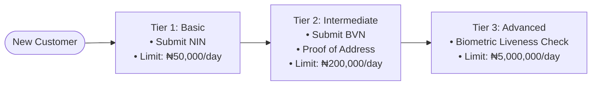

### Account numbers

Accounts use the **10-digit NUBAN** format (9-digit serial + 1 check digit computed with the bank code), the Central Bank of Nigeria standard. Uniqueness is enforced by a database `UNIQUE` constraint.

#### NUBAN generation & CBN check digit algorithm

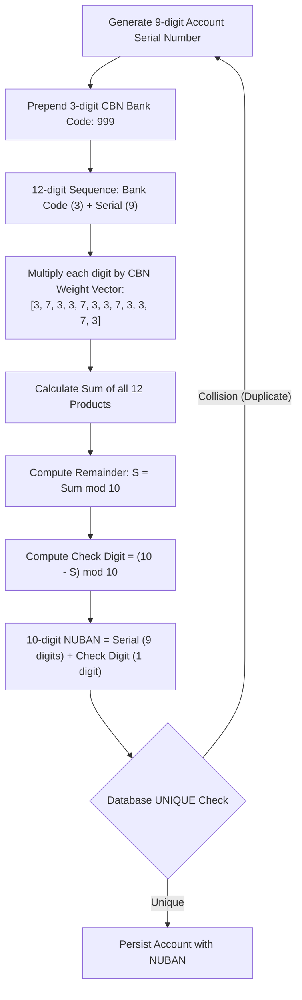

---

## 2. 💰 Money Rules

| Rule | Decision |
|---|---|
| Storage type | **`BIGINT` in minor units** (₦150.75 → `15075` kobo) |
| Currency | Every amount is stored **with an ISO-4217 currency code** (`NGN`) |
| Floats | **Never** used for money, in the database or in code |
| API format | Amounts are sent and returned as **strings in minor units** (`"15075"`), because JavaScript `bigint` can't pass through `JSON.stringify` |

**Why not floats?** `0.1 + 0.2 === 0.30000000000000004`. Floating-point numbers can't represent most decimals exactly. Rounding only hides the error on screen while the stored value stays wrong.

**Why store the currency?** Currencies have different minor units: NGN and USD have 2 decimals, JPY has 0, KWD has 3.

### Money representation flow

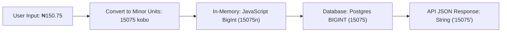

---

## 3. 📒 Ledger Model

### Source of truth: ledger + cached balance

- **Ledger lines are the source of truth.** They are append-only: never updated, never deleted.
- Each ledger account carries a **cached `balance`**, updated **in the same database transaction** as the lines it summarises, so both commit or neither does.
- Mistakes are corrected with **reversal entries**, never by editing history.

### The golden rule

> **Every journal entry's total debits = total credits.**
> An entry that doesn't balance is rejected.

### Account types

| Account | Type | A debit… | A credit… |
|---|---|---|---|
| Customer account | Liability (money the bank owes) | ⬇️ decreases | ⬆️ increases |
| Fee income | Revenue | ⬇️ decreases | ⬆️ increases |
| Settlement / cash | Asset | ⬆️ increases | ⬇️ decreases |

### Worked example: A sends ₦5,000 to B, with a ₦10 fee

One journal entry, three lines:

| # | Account | Debit | Credit |
|:---:|---|---:|---:|
| 1 | Customer A | ₦5,010 | |
| 2 | Customer B | | ₦5,000 |
| 3 | Fee income | | ₦10 |
| | **Total** | **₦5,010** | **₦5,010** ✅ |

### Double-entry structure & account legs

A single economic event produces one journal entry composed of balanced debit and credit legs across distinct chart-of-accounts entries:

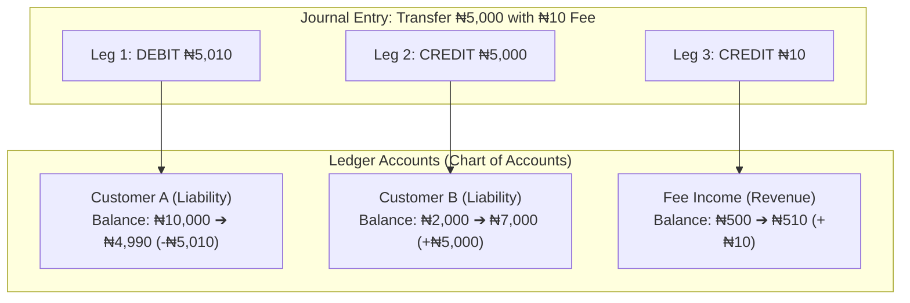

### Posting validation & execution flow

Every posting executed by `LedgerService.post()` enforces double-entry invariants, acquires row locks in sorted order, and rejects any overdraft before committing:

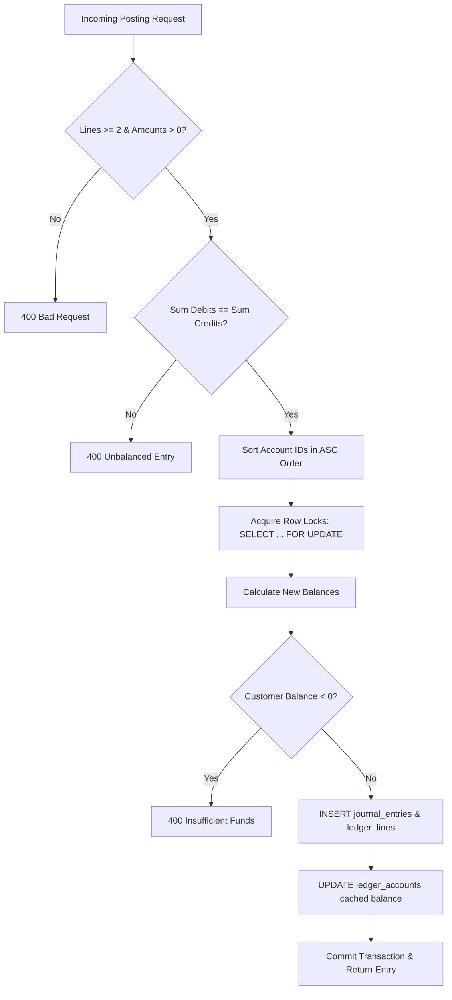

---

## 4. 🔁 Idempotency

**The problem:** a transfer succeeds, the response times out, and the client retries. Without protection, the money moves **twice**.

### Mechanism

The client sends a unique **`Idempotency-Key`** header (a UUID it generates) on every money-moving `POST`.

```http
POST /transfers
Idempotency-Key: 6f1c2a9e-4b7d-4e3a-9a1f-2c8d5e7b0f13
```

### What the server stores

| Field | Purpose |
|---|---|
| `key` + `customer_id` | Unique together, so one customer's keys can't clash with another's |
| `request_hash` | SHA-256 of method + path + body, to detect key reuse with a different body |
| `status` | `IN_PROGRESS` → `COMPLETED` |
| `response_code` + `response_body` | Replayed on retries |
| `expires_at` | Keys expire after 24 hours |

### Behaviour

| Situation | Response |
|---|---|
| New key | Process normally and save the response |
| Same key + same body, **completed** | **Replay** the saved response; nothing moves again |
| Same key, **still in progress** | **`409 Conflict`**: retry later |
| Same key + **different body** | **`422 Unprocessable Entity`**: key already used |
| Expired key | Treated as a new key |

> ⚠️ **Order matters:** the `IN_PROGRESS` row is inserted **before** any money moves. The unique constraint on (`customer_id`, `key`) makes the database reject a second concurrent insert, which is how the 409 case is detected.

The idempotency record is written **in the same transaction** as the transfer. If the transfer rolls back, so does the record, and the client can safely retry.

### Idempotency decision tree & lifecycle

The `idempotency_keys` table acts as a gatekeeper for all money-moving requests, differentiating new requests, network retries, and concurrent duplicates:

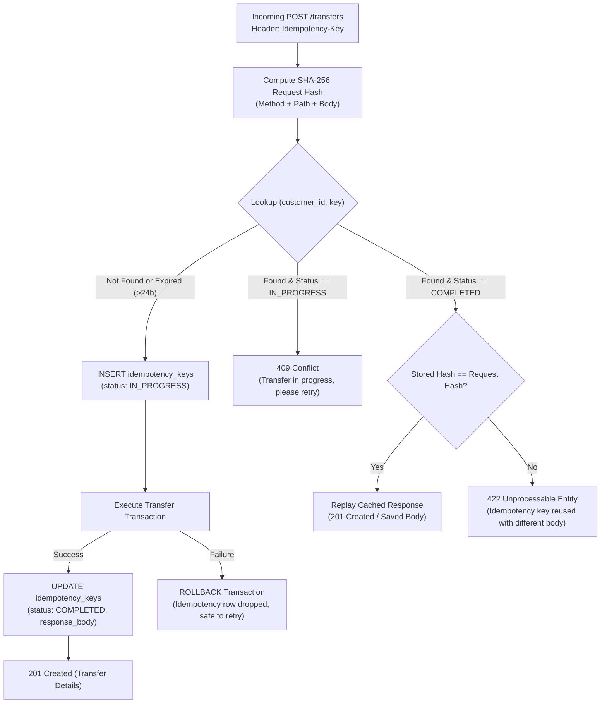

### Rejected alternatives

| Alternative | Problem |
|---|---|
| Duplicate detection (same sender, recipient and amount within 5 minutes) | Blocks legitimate repeat payments |
| Unique constraint on (from, to, amount) | A customer could only ever pay someone ₦5,000 once |
| Forbidding retries | Networks fail; clients **will** retry |

---

## 5. 🔒 Concurrency

**The problem:** A has **₦6,000**. Two **different** transfers of ₦5,000 (different idempotency keys) arrive at the same moment. Without locking, both read ₦6,000, both pass the check, and A ends at **−₦4,000**.

### Idempotency ≠ concurrency

| | **Idempotency** | **Concurrency** |
|---|---|---|
| Situation | The **same** request sent **twice** | **Two different** requests at the **same time** |
| Keys | Same `Idempotency-Key` | Different keys (`K1`, `K2`), both genuine |
| Analogy | The same cheque number presented twice | Two different cheques at two tellers at once |
| Fix | Store key + request hash | **Lock the balance row** |

With `K1` and `K2`, the idempotency table sees two new keys and lets both through. Only the row lock protects the balance. The system needs **both** protections.

### Decision: pessimistic row lock

Every posting runs inside **one database transaction**:

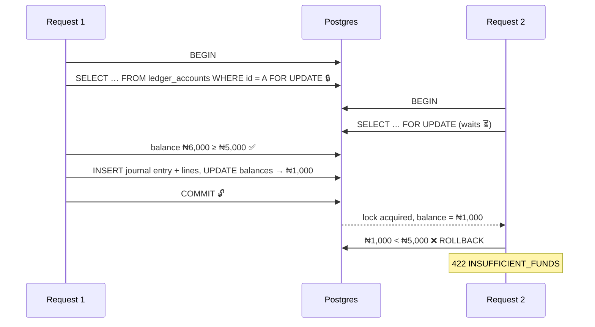

1. `BEGIN` the transaction.
2. **Lock the affected `ledger_accounts` rows** with `SELECT … FOR UPDATE`. Other transactions touching those rows wait.
3. Read the balance **after** taking the lock and check that it covers amount + fee.
4. Insert the journal entry and its lines (debits = credits).
5. Update the cached balances.
6. `COMMIT`, which releases the locks.

### What gets locked

- 🔒 Only the **specific `ledger_accounts` rows** involved: never the whole table.
- A second `SELECT … FOR UPDATE` on the same row **blocks** until the first transaction commits or rolls back.
- `SERIALIZABLE` isolation was considered. It doesn't wait: Postgres aborts one transaction with a serialization failure (`40001`), and the application must retry. Row locks keep the behaviour simpler and predictable.

### Deadlocks and lock ordering

A sends ₦5,000 to B **while** B sends ₦3,000 to A. If each transaction locks *sender first*:

| Time | Tx 1 (A → B) | Tx 2 (B → A) |
|:---:|---|---|
| t1 | 🔒 locks **A** | 🔒 locks **B** |
| t2 | ⏳ waits for **B** | ⏳ waits for **A** |
| t3 | 💀 **Deadlock**: Postgres detects it after ~1s and kills one (`40P01`) | |

**Rule:** accounts are always locked in the **same order, sorted by ledger account ID**, whatever the direction of the transfer. Both transactions then try the lower ID first, so one simply waits and no cycle can form.

> Prisma's query API can't express `FOR UPDATE`, so locking uses `$queryRaw` inside `prisma.$transaction(async (tx) => …)`.

#### Deadlock prevention flow

By sorting all affected ledger account IDs in ascending order (`ORDER BY id ASC`), competing concurrent transactions always acquire locks in the identical order, eliminating circular wait:

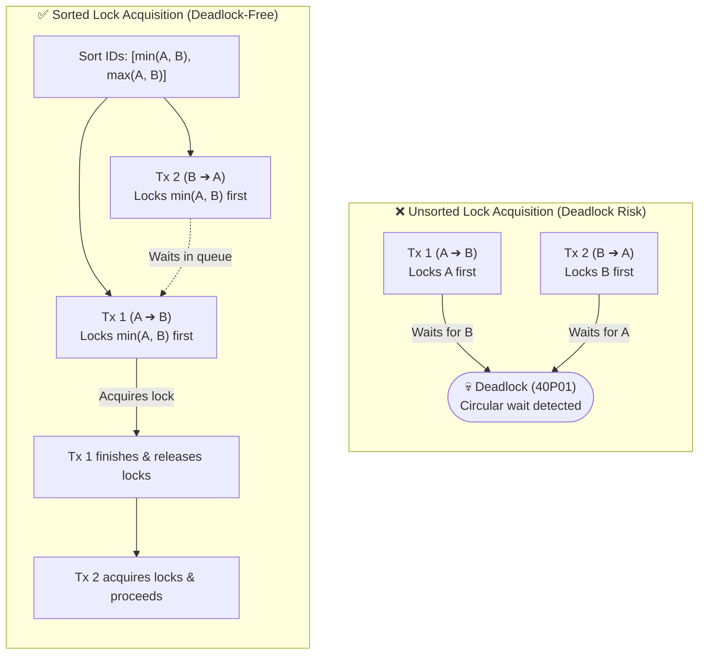

---

## 6. 📦 Phase 1 Scope

### In scope

| Area | Includes |
|---|---|
| Customers & auth | Sign-up (email/phone), OTP verification, login (JWT), forgot password |
| Notifications | **Pluggable `NotificationSender`** interface: console sender in development, email sandbox later, swapped through dependency injection |
| KYC (mocked) | Tiers 1–3 with **daily transfer limits per tier**. NIN/BVN/liveness checks are **mocked**: any correctly formatted value passes |
| Accounts | Account opening, **10-digit NUBAN** account numbers, status |
| Ledger & transfers | Double-entry ledger, deposits, internal transfers, transaction history, idempotency |
| Quality | Validation, error handling, automated tests (including a concurrent-transfer test), Postman collection |

### Deferred

| Deferred | Until | Why |
|---|---|---|
| Background workers | Phase 3 | Phase 1 runs everything inside requests |
| Kafka / events | Phases 5–6 | No consumers yet; a correct core comes first |
| Microservices | Phase 7 | Boundaries are proven inside the monolith first |
| Real KYC providers (NIN/BVN/liveness) | Later phase | Needs third-party sandboxes; mocked in Phase 1 |
| External bank transfers | Later phase | Needs a payment provider; internal transfers first |

---

## 7. 🧩 Module Boundaries

### Rules

1. **Every table has exactly one owner module.** Only the owner reads from or writes to it.
2. Other modules go through the owner's **exported service**, never `prisma.<otherTable>` directly.
3. Dependencies point **one way**. No cycles.
4. **Policy lives at the top, invariants at the bottom.** Use-case modules (Transfers) apply business policy such as KYC limits and ownership checks. The Ledger enforces only accounting invariants: balanced entries, no overdraft, locking.
5. Cross-cutting concerns (validation, errors, idempotency, logging) live in `common/`, not in domain modules.

### Modules

| Module | Responsibility | Owns (tables) | Exports |
|---|---|---|---|
| `AuthModule` | Sign-up, login (JWT), OTP, forgot password | `credentials`, `otp_codes`, `refresh_tokens` | `AuthService` |
| `CustomersModule` | Customer profile | `customers` | `CustomersService` |
| `KycModule` | Tiers, mocked NIN/BVN/liveness, **limit policy** | `kyc_verifications` | `KycService` |
| `AccountsModule` | Account opening, NUBAN generation, status, **balance & history endpoints** | `accounts` | `AccountsService` |
| `LedgerModule` | **The only writer of money.** Postings, the debit = credit rule, balances, row locks. **No controller.** | `ledger_accounts`, `journal_entries`, `ledger_lines` | `LedgerService` only |
| `TransfersModule` | Use-case orchestration: idempotency → ownership → limits → post to the ledger | `transfers` | — |
| `NotificationsModule` | Asynchronous notification queue (BullMQ), worker processor with exponential backoff retries, pluggable `NotificationSender` | — | `NotificationsService` |
| `PrismaModule` *(infrastructure)* | Database client and lifecycle. **Not global**: imported explicitly by every module that owns tables. | — | `PrismaService` |
| `common/` *(not a module)* | Idempotency interceptor, exception filters, validation pipes | `idempotency_keys` | — |

`AppModule` only **composes** modules. It never registers domain controllers or services itself.

### Authentication & Registration Flow

The registration and login lifecycle enforces password security (bcrypt), temporary OTP verification with attempt lockouts, and signed JWT issuance:

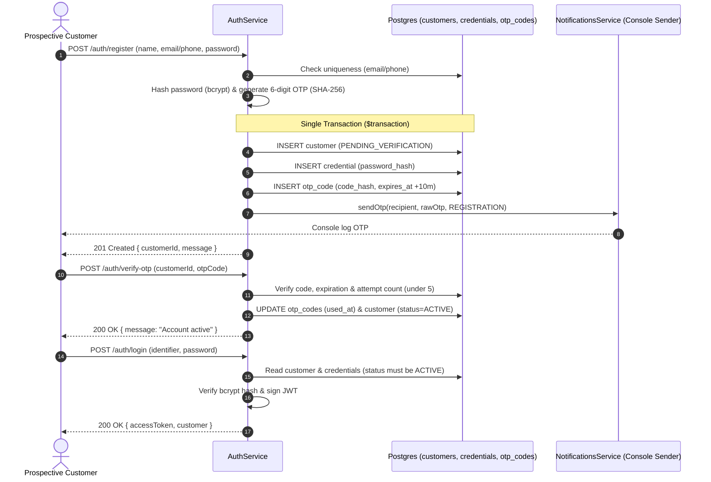

### One transaction across modules

A transfer must save the idempotency record, the transfer row and the ledger postings **atomically**, but those tables have different owners. The orchestrating service opens **one** transaction and **passes the transaction client** (`tx`) into each owner's service:

```ts
await prisma.$transaction(async (tx) => {
  await idempotency.start(tx, …);   // writes idempotency_keys
  await transfers.create(tx, …);    // writes transfers
  await ledger.post(tx, …);         // writes ledger tables
});
```

Each service still writes only its own tables, but all writes commit or roll back together. Events or message brokers are **not** used for this: they can't provide atomicity and would replace a guarantee with eventual consistency.

#### Transfer orchestration flow

`TransfersModule` coordinates idempotency, validation, and ledger updates across module boundaries within a single atomic database transaction:

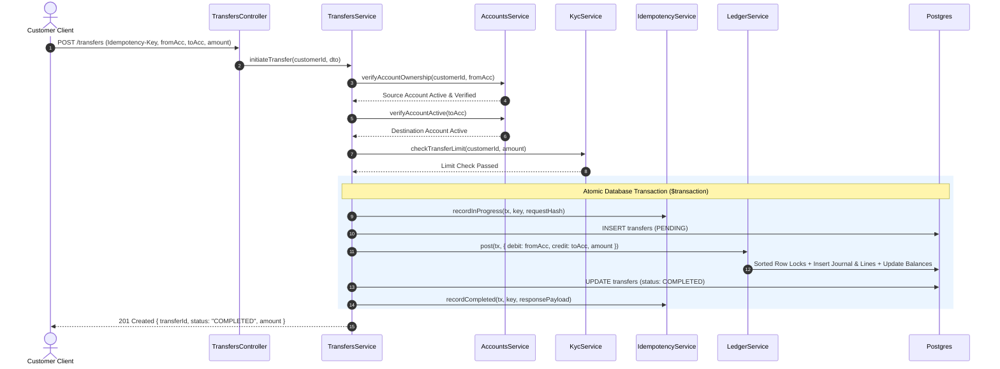

### Account Opening & Ledger Linkage Flow

When an active customer opens a bank account, `AccountsService` and `LedgerService` coordinate atomically across the module boundary within a single transaction without violating table ownership:

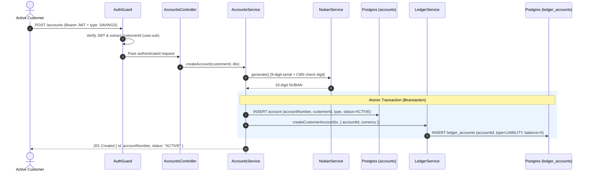

### Reads go through the owner too

Balance and transaction history are served by `AccountsController`. `AccountsService` calls `LedgerService.getBalance()` and `LedgerService.getHistory()`; it never queries ledger tables. This keeps the Ledger free to change its schema, and extractable as a service in Phase 7.

#### Read path encapsulation flow

Balance and transaction inquiries always query through the owning service boundary, preserving domain encapsulation:

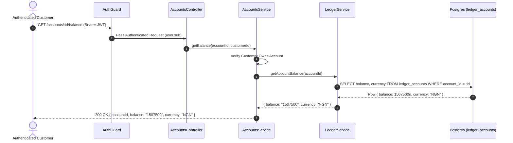

### Dependency direction

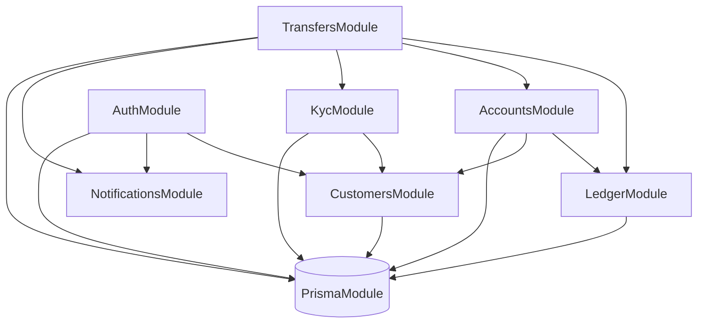

`LedgerModule` depends on **no other domain module**. It knows about money, not about people, OTPs or tiers.

---

## 8. 🗄️ Data Model

### Identifiers

- **Primary keys are UUID v7** (RFC 9562), stored as native Postgres `uuid`. They are unguessable, can be generated anywhere, and are **time-ordered**, so B-tree indexes stay compact.
- **NUBAN account numbers are a separate `UNIQUE` business key** (`CHAR(10)`), never the primary key.

| Rejected | Problem |
|---|---|
| Auto-increment IDs | `/accounts/42` invites guessing other IDs (IDOR attacks) and leaks business volume |
| UUID v4 | Random order scatters inserts across the index, slowing writes at scale |
| NUBAN as the primary key | Business identifiers can change (re-numbering, migrations); keys must never change |

### Column conventions

| Convention | Rule |
|---|---|
| Naming | Prisma models use camelCase; Postgres tables and columns use **snake_case** via `@map` / `@@map` |
| Timestamps | Always **`timestamptz(3)`**: an exact instant, stored as UTC. Daily limits, cut-offs and audit trails stay unambiguous across time zones. |
| Fixed-length codes | `CHAR(n)` so the database rejects wrong lengths (`account_number CHAR(10)`, `currency CHAR(3)`) |
| Format checks | `CHECK` constraints in migration SQL as a backstop, e.g. `account_number ~ '^[0-9]{10}$'` |
| Foreign keys | Always **indexed** (Postgres doesn't index them automatically) |
| Deletes | Customers and accounts are **closed**, never deleted |

### Enumerations

| Enum | Values |
|---|---|
| `CustomerStatus` | `PENDING_VERIFICATION` · `ACTIVE` · `SUSPENDED` · `CLOSED` |
| `AccountStatus` | `ACTIVE` · `SUSPENDED` · `CLOSED` |
| `AccountType` | `SAVINGS` · `CURRENT` |

### Ledger structure: journal + lines

- **`journal_entries`**: one row per financial event (a transfer, a fee, a reversal).
- **`ledger_lines`**: two or more rows per entry, each with a ledger account, a `direction` (`DEBIT` / `CREDIT`) and a **positive** `BIGINT` amount (`CHECK (amount > 0)`).
- All lines in one entry share the **same currency**, and **Σ debits = Σ credits** is verified in `LedgerService` before commit.

A single `transactions` table (from, to, amount) was rejected: it can't represent entries with 3+ legs (fees) or internal accounts cleanly.

### Ledger accounts (chart of accounts)

Not every account money sits in belongs to a customer (e.g. **Fee income**, **Settlement**). The Ledger keeps its own `ledger_accounts` table, which also holds the cached balance:

| Column | Notes |
|---|---|
| `id` | UUID v7 |
| `account_id` | Links to `accounts.id` for customer accounts; `NULL` for internal accounts |
| `code` | e.g. `FEE_INCOME`, `SETTLEMENT_NGN`, for internal accounts |
| `type` | `ASSET` · `LIABILITY` · `REVENUE` · `EXPENSE` · `EQUITY` |
| `currency` | ISO-4217, e.g. `NGN` |
| `balance` | `BIGINT` minor units, updated in the same transaction as the lines |

The `accounts` table therefore has **no balance column**.

### Immutability

Ledger tables are **append-only, enforced in Postgres**: a trigger rejects any `UPDATE` or `DELETE` on `journal_entries` and `ledger_lines`. Application code never edits them either, but the database is the last line of defence against bugs, scripts and manual SQL sessions. Corrections are new **reversal** entries.

#### Append-only trigger enforcement

PostgreSQL triggers enforce write-once immutability directly at the database engine level, rejecting unauthorized mutations even if attempted via raw SQL:

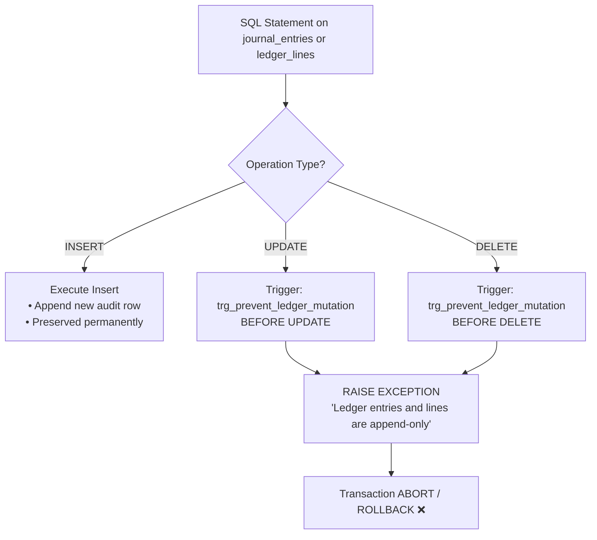

### Secrets & OTPs

Password hashes live in a separate **`credentials`** table owned by `AuthModule`, never on `customers`. Many modules, queries and exports read customer data; keeping secrets elsewhere limits the blast radius of any leak or over-broad query.

One-time passcodes live in **`otp_codes`** with their code hashed (`code_hash`), an expiration timestamp (`expires_at`), an attempt counter (`attempts`), and an enum purpose (`REGISTRATION`, `PASSWORD_RESET`, `LOGIN`). Raw OTPs are never stored in plaintext.

### Cross-module foreign keys

Foreign keys across module boundaries (e.g. `accounts.customer_id → customers.id`) are **allowed in the monolith**, where one database gives referential integrity for free. When modules become separate services (Phase 7), these become plain ID references, validated through the owner's API or events.

### Entity overview

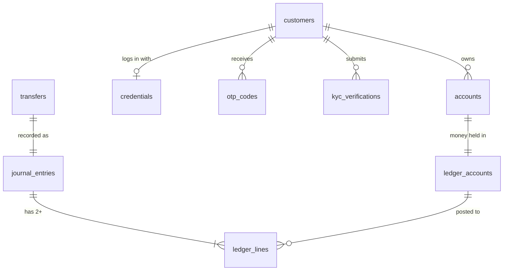

---

## 9. 🧱 Stack & Rationale

| Layer | Choice |
|---|---|
| Language | TypeScript (strict mode) |
| Framework | **NestJS 12** |
| Data layer | **Prisma 7** with the `pg` driver adapter, plus raw SQL for row locks |
| Database | **PostgreSQL 16** (Alpine image) |
| Background Queues | **BullMQ 6** with **Redis 7** (Alpine image) |
| Containerization | **Docker & Docker Compose** (multi-stage, non-root `USER node`) |
| CI/CD Quality Gates | **GitHub Actions** (6-tier automated verification pipeline) |
| Configuration | `@nestjs/config`, loaded once and fail-fast on missing values |
| Testing | Vitest, Postman |

### Why NestJS?

- **Modules map to bounded contexts.** Accounts, Ledger and Auth are separate modules inside the monolith; when services are extracted in Phase 7, each module becomes a service.
- **Built-in microservice transports**, including Kafka, support Phases 6–7.
- **Dependency injection** makes services testable: real dependencies are swapped for fakes in tests.
- An enterprise structure familiar from Java (Spring) and C# (.NET), widely used by fintech teams.

### Known trade-offs

- Prisma can't express row locks through its query API → raw SQL for that one critical path.
- Prisma returns `BIGINT` as `bigint` → amounts are serialised as strings.
- NestJS has a learning curve (modules, providers, guards, pipes, interceptors).

---

## 10. 🛠️ Engineering Standards

| Area | Standard |
|---|---|
| Dependency versions | Pinned **exactly** (`--save-exact`); no pre-release (`-rc`, `-beta`, `-dev`) packages; companion packages kept on the same version (e.g. `prisma` + `@prisma/client`) |
| Lockfile | `package-lock.json` is committed; CI installs with `npm ci` |
| Install scripts | Blocked by default; only reviewed packages are allow-listed |
| Imports | Every imported package is declared in `package.json` (no phantom dependencies) |
| Secrets | Only in environment variables; `.env` is never committed; `.env.example` documents every key |
| Generated code | The Prisma client (`src/generated/`) is generated, never committed |
| Code generation | No CRUD generators (`nest g resource`): every endpoint is added deliberately, and money records have no update or delete endpoints |
| Migrations | SQL is generated with `--create-only`, reviewed, then applied. Applied migrations are never edited. |
| Commits | Conventional Commits (`feat:`, `fix:`, `chore:`, `refactor:`, `docs:`, `test:`) |
| Quality gate | `npm run lint`, `npm run build` and `npm test` pass before every commit |

---

## 11. 🚢 Delivery & Containerization Architecture (Phase 2)

### Container Architecture & Network Mesh

Production isolation guarantees that the application runs uniformly across developer workstations, staging environments, and production clusters.

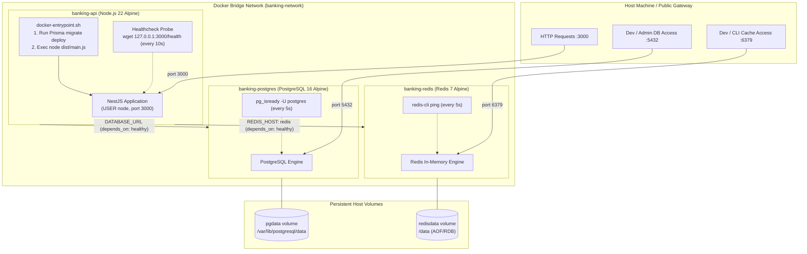

### Multi-Stage Secure Dockerfile Pipeline

The build uses a 3-stage pattern to produce a minimal, vulnerability-reduced production image:

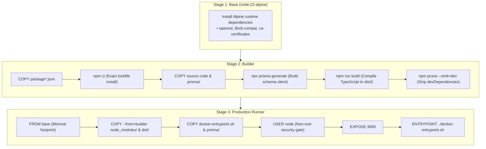

### Automated CI/CD Quality Gates Pipeline

Every Pull Request and commit to `master` must pass 6 non-negotiable automated quality gates before release:

```mermaid
flowchart LR
    Push(["Push / PR to master"]) --> Gate1["1. Oxlint & Type-Aware Analysis<br/>• Zero warnings / zero errors"]
    Gate1 --> Gate2["2. Prisma Generate & Migration Validation<br/>• Schema sync & valid SQL"]
    Gate2 --> Gate3["3. TypeScript Nest Build<br/>• Strict compilation to dist/"]
    Gate3 --> Gate4["4. Vitest Unit Test Suite<br/>• 100% test passing"]
    Gate4 --> Gate5["5. PostgreSQL Concurrency E2E<br/>• 20 parallel cross-transfers<br/>• 0 deadlocks (40P01)"]
    Gate5 --> Gate6["6. Multi-Stage Docker Build<br/>• Image build & runner validation"]
    Gate6 --> Deploy(["Deployable Release Artifact ✅"])
```

---

## 12. ⚡ Asynchronous Queues & Background Processing (Phase 3)

### The Queue Engine Architecture

Synchronous operations like external Telco/SMS OTP dispatch or third-party email notifications are extracted from the HTTP cycle and routed through a persistent Redis-backed BullMQ buffer:

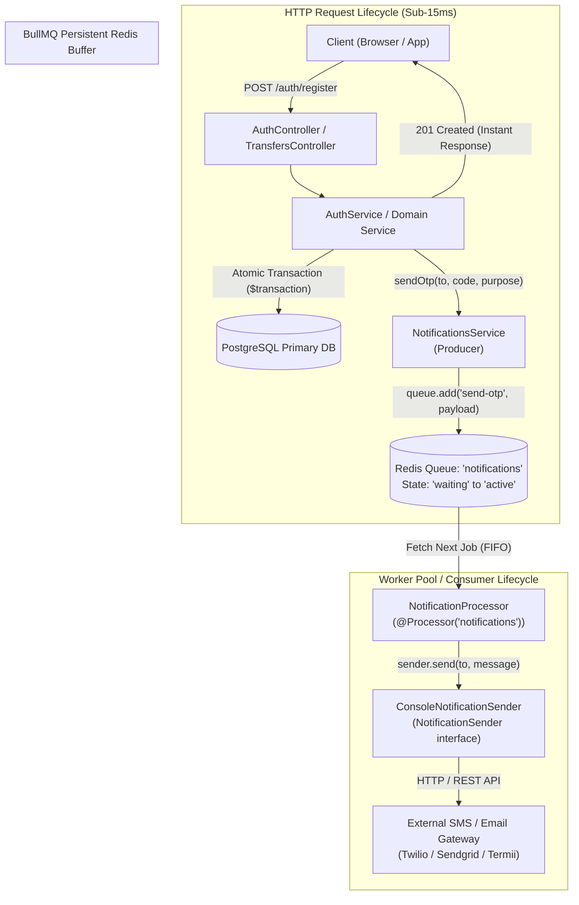

### Job Lifecycle, Exponential Backoff & Dead-Letter Auditing

External network communication is inherently unreliable. The background worker applies an automated exponential backoff retry policy before dead-lettering:

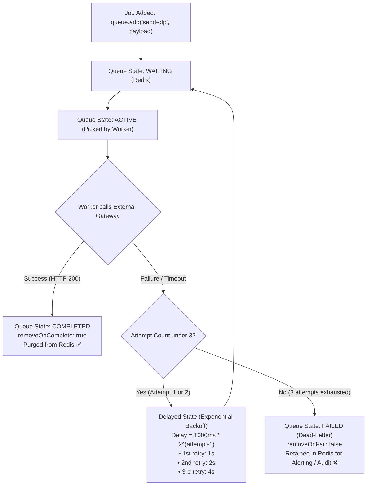

### Registration & Asynchronous Notification Sequence

```mermaid
sequenceDiagram
    autonumber
    actor User as Prospective Customer
    participant Auth as AuthService
    participant DB as Postgres (customers, credentials, otp_codes)
    participant Producer as NotificationsService (Producer)
    participant Redis as Redis (BullMQ: notifications)
    participant Worker as NotificationProcessor (Worker)
    participant Sender as NotificationSender

    User->>Auth: POST /auth/register (name, email/phone, password)
    Auth->>DB: Check uniqueness (email/phone)
    Auth->>Auth: Hash password (bcrypt) & generate 6-digit OTP (SHA-256)
    Note over Auth,DB: Single Transaction ($transaction)
    Auth->>DB: INSERT customer (PENDING_VERIFICATION)
    Auth->>DB: INSERT credential (password_hash)
    Auth->>DB: INSERT otp_code (code_hash, expires_at +10m)
    
    Auth->>Producer: sendOtp(recipient, rawOtp, REGISTRATION)
    Producer->>Redis: queue.add('send-otp', { to, code, purpose }, { attempts: 3, backoff: 'exponential' })
    Redis-->>Producer: Job enqueued (#id)
    Producer-->>Auth: Promise resolved (instant)
    Auth-->>User: 201 Created { customerId, message } (Latency under 25ms)

    Note over Redis,Worker: Asynchronous Background Execution
    Redis->>Worker: Dispatch job #id
    Worker->>Sender: send(to, message)
    Sender-->>Worker: SMS/Email Delivered
    Worker->>Redis: Mark job completed
```

### Asynchronous Debit & Credit Transaction Alerts

Alerts run **post-commit** outside the database transaction, eliminating any chance of phantom alerts or transaction delays:

```mermaid
sequenceDiagram
    autonumber
    actor Alice as Sender (Alice)
    actor Bob as Recipient (Bob)
    participant Ctrl as TransfersController
    participant Svc as TransfersService
    participant DB as Postgres ($transaction)
    participant Queue as Redis Queue ('notifications')
    participant Worker as NotificationProcessor
    participant Sender as NotificationSender

    Alice->>Ctrl: POST /transfers (from Alice to Bob, ₦5,000)
    Ctrl->>Svc: transfer(...)
    Svc->>DB: Atomically check locks, post ledger, create transfer & update idempotency
    DB-->>Svc: Commit Success (201 Created)
    Svc->>Queue: Enqueue 'send-transaction-alert' (DEBIT to Alice)
    Svc->>Queue: Enqueue 'send-transaction-alert' (CREDIT to Bob)
    Svc-->>Ctrl: Return responsePayload
    Ctrl-->>Alice: 201 Created { id, amount: "500000", status: "COMPLETED" } (Instant!)

    Note over Queue,Worker: Background Asynchronous Delivery
    Queue->>Worker: Dispatch DEBIT alert
    Worker->>Sender: send(Alice, "[ALERT] DEBIT of NGN 5,000...")
    Queue->>Worker: Dispatch CREDIT alert
    Worker->>Sender: send(Bob, "[ALERT] CREDIT of NGN 5,000...")
```

### Scheduled Midnight Double-Entry Ledger Audit

An autonomous background cron runner executes at `00:00:00 UTC` to verify system-wide financial equilibrium:

```mermaid
flowchart TD
    Schedule(["⏰ Cron: 00:00:00 UTC Daily"]) --> Start["LedgerReconciliationService.reconcile()"]
    Start --> Debits["Aggregate: SUM(amount) WHERE direction = DEBIT"]
    Start --> Credits["Aggregate: SUM(amount) WHERE direction = CREDIT"]
    Debits --> Diff["Compute Drift: Diff = Total Debits - Total Credits"]
    Credits --> Diff
    Diff --> Check{"Is Drift === 0n?"}
    Check -- "Yes (Drift = 0)" --> Healthy["Emit Audit Log:<br/>✅ [LedgerReconciliation] System balanced.<br/>Stamp ledger as in equilibrium"]
    Check -- "No (Drift != 0)" --> Alarm["🚨 Emit Critical Alarm:<br/>[CRITICAL_LEDGER_IMBALANCE]<br/>Throw exception to trigger platform alert"]
```

---

## 13. ⚡ High-Throughput Concurrency, Load Proof & Database Tuning (Phase 4)

In commercial banking, money transfer engines must endure catastrophic spikes in concurrency (e.g. Black Friday flash sales, concert ticket drops, or mass payroll releases) without deadlocking or allowing balance drift.

Phase 4 subjected the Banking API to rigorous load testing using **k6 v2.3.0** across two foundational stress scenarios:

### 13.1 Scenario A: Hot-Account Row Contention Architecture

When thousands of customers pay the exact same merchant at the exact same millisecond, multiple transactions contend for exclusive write locks on that single `ledger_accounts` row.

```mermaid
flowchart TD
    VU1["Virtual User 01"] -->|"POST /transfers"| API["Banking API (NestJS 12)"]
    VU2["Virtual User 02"] -->|"POST /transfers"| API
    VU50["Virtual User 50"] -->|"POST /transfers"| API

    API -->|"id ASC Sorted Locking"| LockQueue["PostgreSQL Row-Lock Queue<br/>(SELECT ... FOR UPDATE)"]
    LockQueue -->|"Tx 1 acquires lock"| MerchantRow["Merchant Ledger Row<br/>(Acquire -> Post -> Commit)"]
    MerchantRow -->|"Tx 1 releases lock"| LockQueue
    LockQueue -->|"Tx 2 acquires lock"| MerchantRow
```

#### Empirical Results
* **Concurrency:** 50 concurrent Virtual Users hammering merchant account `6121823541`.
* **Throughput:** **184.17 requests / second** (5,532 transfers completed in 30 seconds).
* **Deadlock Frequency:** **0.00%** (0 deadlocks out of 5,532 attempts).
* **Balance Drift:** **0 kobo** (Exact to the minor unit).
* **p95 Latency:** **222.19 ms** · **p99 Latency:** **378.70 ms**.

---

### 13.2 Scenario B: Dispersed Load & Connection Pool Multiplexing

When accounts transfer money across dispersed pairs (ring topology: Sender $i \to$ Sender $i+1$), single-row contention disappears, and the bottleneck shifts to **PostgreSQL connection pool multiplexing**.

```mermaid
flowchart TD
    Clients["100 Concurrent Virtual Users"] -->|"Ring Transfers"| NestApp["NestJS Event Loop"]
    NestApp -->|"PrismaPg Adapter"| Pool["Tuned Connection Pool<br/>(max: 30 sockets)"]

    Pool -->|"Socket 1..10"| DB1["Active Transactions (1..10)"]
    Pool -->|"Socket 11..20"| DB2["Active Transactions (11..20)"]
    Pool -->|"Socket 21..30"| DB3["Active Transactions (21..30)"]

    DB1 -->|"Commit & Release"| Pool
    DB2 -->|"Commit & Release"| Pool
    DB3 -->|"Commit & Release"| Pool
```

#### Connection Pool Tuning Transformation
By upgrading the default `pg.Pool` configuration in [PrismaService](file:///Users/macbook/Documents/GitHub/Banking-API/src/infrastructure/prisma/prisma.service.ts) from default `max: 10` to `max: 30` with `connectionTimeoutMillis: 5000`:
* **Throughput:** Increased from 117.88 RPS to **211.34 RPS** (+79.3% throughput gain).
* **Error Rate:** Dropped from 0.07% (timeouts) to **0.00%** (0 errors out of 7,397 requests).
* **p95 Latency:** Slashed from 2,350 ms down to **483.66 ms** (4.8x faster).
* **p99 Latency:** Slashed from 5,530 ms down to **552.52 ms** (10.0x faster).
* **Max Latency:** Dropped from 6,300 ms down to **968.90 ms** (Sub-second peak).

Full benchmark documentation is available in [BENCHMARKS.md](file:///Users/macbook/Documents/GitHub/Banking-API/docs/BENCHMARKS.md).

Full benchmark documentation is available in [BENCHMARKS.md](file:///Users/macbook/Documents/GitHub/Banking-API/docs/BENCHMARKS.md).

---

## 14. 📡 Domain Events, Transactional Outbox & Distributed Streaming with Apache Kafka (Phase 5 & 6)

### 14.1 The Dual-Write Problem
In distributed banking architectures, a common failure mode is the **Dual-Write Hazard**:
1. **Scenario A (Network drop after DB commit):** The application updates account balances and commits the PostgreSQL transaction. Then, it attempts to publish an event across the network to Apache Kafka. The network drops, the Kafka broker times out, or the process crashes. Result: The money moved in the database, but downstream fraud, notification, and compliance services never received the event.
2. **Scenario B (Database rollback after Kafka publish):** The application publishes an event to Kafka first, then attempts to commit the database transaction. PostgreSQL rejects the transaction (e.g., balance exhaustion or constraint violation). Result: Phantom money moved across Kafka, triggering false notifications and ledger anomalies.

To achieve 100% financial consistency, **network calls must never occur inside or immediately adjacent to database transactions**.

```mermaid
flowchart TD
    subgraph AntiPattern["❌ The Dual-Write Hazard"]
        direction TB
        App1["Banking API"] -->|"1. Commit ACID Tx"| DB1[("PostgreSQL")]
        App1 -.->|"2. Network Failure!"| BrokenKafka[("Apache Kafka<br/>(Event Silently Lost!)")]
    end
    subgraph OutboxPattern["✅ The Transactional Outbox Pattern"]
        direction TB
        App2["Banking API"] -->|"Atomic Tx: Money + Outbox Row"| DB2[("PostgreSQL<br/>outbox_events")]
        DB2 -->|"Async Relay Sweeper<br/>(SKIP LOCKED)"| Relay["OutboxRelayService"]
        Relay -->|"Guaranteed Delivery"| HealthyKafka[("Apache Kafka<br/>(Streamed Reliably)")]
    end
```

### 14.2 The Padlock & Prototype Framework Mental Model

1. **The Anchor (Human Purpose):** If a customer transfers ₦50,000, we must notify downstream fraud analyzers and central bank compliance without ever creating phantom money or dropping real audit events, even if Kafka is down for maintenance.
2. **The Mini-Me (Scale it Down):** For a single ₦10 transfer, exactly 2 database rows are inserted in the exact same database split-second: 
   * Row 1: The `transfers` record (status: `COMPLETED`).
   * Row 2: The `outbox_events` record (status: `PENDING`).
3. **The Crash Test (Simulate Failure):**
   * *Crash Test A (Database rollback):* If the transfer fails KYC or balance rules, PostgreSQL rolls back *both* the transfer and the outbox row. Zero ghost messages.
   * *Crash Test B (Kafka broker crash):* If Kafka goes offline, transfers continue to succeed. Outbox rows simply queue safely in PostgreSQL as `PENDING`. When Kafka recovers, the sweeper picks up the pending backlog and resumes streaming with zero data loss.
4. **The Logic (Physical Equivalent):** The **Bank Teller's Outbox Tray**. The teller never walks across town to the post office during a customer's transaction. They drop the transaction receipt into a physical outbox tray on their desk. An internal mail courier walks by every 500ms, empties the tray, and transports the letters.

### 14.3 Architecture & Data Flow

```mermaid
flowchart LR
    Client["Client HTTP Request"] -->|"1. POST /transfers"| API["TransfersService"]
    subgraph PG["PostgreSQL (Single Atomic ACID Transaction)"]
        direction TB
        Tx["BEGIN"] --> Locks["Sort & Lock Accounts"]
        Locks --> Ledger["Post Ledger Journal"]
        Ledger --> Transfer["Create Transfer Row"]
        Transfer --> Outbox["Insert outbox_events (PENDING)"]
        Outbox --> Commit["COMMIT"]
    end
    API -->|"Execute"| PG
    subgraph Sweeper["Outbox Relay Sweeper (Every 500ms)"]
        direction TB
        Fetch["SELECT ... FOR UPDATE SKIP LOCKED"] --> Dispatch["Publish to Kafka"]
        Dispatch --> UpdateStatus["UPDATE status = PUBLISHED"]
    end
    PG -->|"Poll Pending"| Sweeper
    Sweeper -->|"Partition Key: aggregateId"| Kafka[("Apache Kafka<br/>topic: banking.transfers")]
    Kafka -->|"Real-Time Consumer"| Audit["Kafka Consumer<br/>(Audit & Fraud Stream)"]
```

### 14.4 Safe Parallel Sweeping (`FOR UPDATE SKIP LOCKED`)
Multiple instances of the Banking API can run concurrently in production without contending for the same outbox events. The relay sweeper utilizes:

```sql
SELECT id, aggregate_type, aggregate_id, event_type, payload
FROM outbox_events
WHERE status = 'PENDING'
ORDER BY created_at ASC
LIMIT 50
FOR UPDATE SKIP LOCKED;
```

* **Zero Lock Contention:** `SKIP LOCKED` instructs PostgreSQL to immediately ignore rows currently locked by another worker thread or container pod, allowing horizontal worker scaling with zero lock wait timeouts.
* **Strict Aggregate Ordering:** Kafka messages are keyed by `aggregateId` (e.g. `transferId` or `accountId`), guaranteeing that events for any given entity land on the exact same Kafka partition and maintain FIFO ordering.

---

## 15. 📋 Decision Log

| ID | Decision | Section |
|:---:|---|:---:|
| ADR-01 | Money is `BIGINT` minor units with an ISO-4217 currency; never floats | [2](#2--money-rules) |
| ADR-02 | Ledger lines are the source of truth; balances are cached in the same transaction | [3](#3--ledger-model) |
| ADR-03 | Double-entry: every journal entry balances | [3](#3--ledger-model) |
| ADR-04 | `Idempotency-Key` header with request hash; 409 in progress, 422 on mismatch | [4](#4--idempotency) |
| ADR-05 | Pessimistic row locks on `ledger_accounts`, acquired in ID order | [5](#5--concurrency) |
| ADR-06 | NUBAN 10-digit account numbers | [1](#1--purpose) |
| ADR-07 | Pluggable `NotificationSender` for OTPs | [6](#6--phase-1-scope) |
| ADR-08 | KYC tiers with daily limits; verification mocked in Phase 1 | [6](#6--phase-1-scope) |
| ADR-09 | One owner per table, for reads and writes | [7](#7--module-boundaries) |
| ADR-10 | Balance lives in the Ledger's `ledger_accounts`, not on `accounts` | [8](#8--data-model) |
| ADR-11 | Cross-module atomicity by passing the transaction client | [7](#7--module-boundaries) |
| ADR-12 | Policy checks in use-case modules; accounting invariants in the Ledger | [7](#7--module-boundaries) |
| ADR-13 | Ledger has no controller; `AccountsController` serves balance and history | [7](#7--module-boundaries) |
| ADR-14 | `LedgerModule` exports only `LedgerService` | [7](#7--module-boundaries) |
| ADR-15 | `PrismaModule` is imported explicitly, not global | [7](#7--module-boundaries) |
| ADR-16 | UUID v7 primary keys; NUBAN as a separate unique business key | [8](#8--data-model) |
| ADR-17 | Journal + lines ledger structure with a chart of accounts | [8](#8--data-model) |
| ADR-18 | Ledger tables are append-only, enforced by a Postgres trigger | [8](#8--data-model) |
| ADR-19 | Password hashes in a separate `credentials` table | [8](#8--data-model) |
| ADR-20 | Cross-module foreign keys allowed in the monolith only | [8](#8--data-model) |
| ADR-21 | All timestamps are `timestamptz` | [8](#8--data-model) |
| ADR-22 | Database-level `CHECK` constraints back up application validation | [8](#8--data-model) |
| ADR-23 | OTP codes stored hashed with expiration, attempt limit, and purpose enum | [8](#8--data-model) |
| ADR-24 | Multi-stage Docker containerization with non-root security gate (`USER node`) and container healthcheck probes | [11](#11--delivery--containerization-architecture-phase-2) |
| ADR-25 | 6-tier automated CI/CD pipeline blocking unlinted or non-migratable code before deploy | [11](#11--delivery--containerization-architecture-phase-2) |
| ADR-26 | Redis 7 persistent backing buffer for asynchronous queues | [12](#12--asynchronous-queues--background-processing-phase-3) |
| ADR-27 | Decoupled BullMQ background job processing with exponential backoff retries for external communications | [12](#12--asynchronous-queues--background-processing-phase-3) |
| ADR-28 | Autonomous scheduled midnight double-entry ledger reconciliation audit (`@nestjs/schedule`) | [12](#12--asynchronous-queues--background-processing-phase-3) |
| ADR-29 | Post-commit asynchronous dispatching of debit and credit transaction alerts | [12](#12--asynchronous-queues--background-processing-phase-3) |
| ADR-30 | Deterministic Lexicographical Row-Locking (`ORDER BY id ASC FOR UPDATE`) under High Load | [13](#13--high-throughput-concurrency-load-proof--database-tuning-phase-4) |
| ADR-31 | PostgreSQL Driver Adapter (`PrismaPg`) Connection Pool Tuning (`max: 30`, `idleTimeoutMillis: 30000`, `connectionTimeoutMillis: 5000`) | [13](#13--high-throughput-concurrency-load-proof--database-tuning-phase-4) |
| ADR-32 | Automated Post-Load Double-Entry Accounting Audit for Balance Drift Detection | [13](#13--high-throughput-concurrency-load-proof--database-tuning-phase-4) |
| ADR-33 | Transactional Outbox Pattern for Zero-Loss Domain Event Atomicity | [14](#14--domain-events-transactional-outbox--distributed-streaming-with-apache-kafka-phase-5--6) |
| ADR-34 | Safe Distributed Outbox Sweeping via PostgreSQL `FOR UPDATE SKIP LOCKED` | [14](#14--domain-events-transactional-outbox--distributed-streaming-with-apache-kafka-phase-5--6) |
| ADR-35 | Distributed Event Streaming & Decoupled Consumer Ingestion via Apache Kafka (KRaft mode) | [14](#14--domain-events-transactional-outbox--distributed-streaming-with-apache-kafka-phase-5--6) |
| ADR-36 | Partition Key Ordering by Aggregate Identifier for Strict FIFO Sequencing | [14](#14--domain-events-transactional-outbox--distributed-streaming-with-apache-kafka-phase-5--6) |

---

## 16. ❓ Open Questions

| # | Question | Status | Notes |
|:---:|---|:---:|---|
| 1 | How are NUBAN serials generated? | Resolved | 9 random serial digits + 1 Central Bank of Nigeria check digit with collision retry loop |
| 2 | What are the daily limits per tier? | Resolved | Tier 1: ₦50k/day, Tier 2: ₦200k/day, Tier 3: ₦5m/day |
| 3 | Pessimistic locks vs optimistic locking vs conditional `UPDATE` | **Resolved & Proven** | Pessimistic sorted locks sustained 211+ RPS under 100 concurrent VUs with 0 deadlocks, 0 balance drift, and sub-second p99 latency |
| 4 | Should accounts support "Post No Debit" (PND)? | Open | Incoming money allowed, outgoing blocked; common during fraud or KYC reviews |
| 5 | What is the retention policy for `outbox_events` table? | Open | Purge published events older than 30 days via a scheduled partition drop or archive worker |
