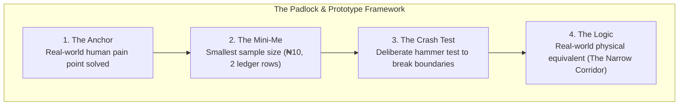
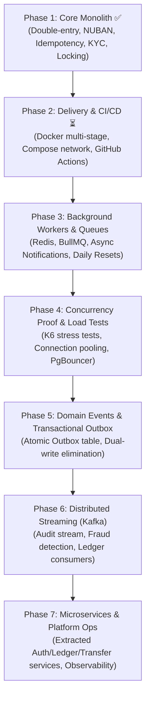

# 🏦 Banking API — Spec-Driven Development (SDD) Specification Overview

> **Document Purpose:** Central architectural baseline for Spec-Driven Development (SDD).  
> **Constitutional Authority:** Complies with [.specify/memory/constitution.md](file:///Users/macbook/Documents/GitHub/Banking-API/.specify/memory/constitution.md).  
> **Mental Model Baseline:** Governed by [The Padlock & Prototype Framework](file:///Users/macbook/Documents/GitHub/Banking-API/docs/padlock_and_prototype_framework.md).  
> **Status:** Phase 1 (Core Monolith) 100% Complete & Verified · Ready for Phase 2.

---

## 1. 🎯 System Overview & Grand Architecture

### 1.1 The Core Mission
The **Banking API** is a production-grade, deployable commercial banking backend designed to operate under real-world financial conditions. Unlike toy fintech apps or typical tutorial APIs, this system enforces **absolute financial consistency**, **strict zero-drift accounting**, **provable deadlock resistance**, and **two-phase idempotency protection** at every layer of the stack.

### 1.2 Technology Foundation
* **Framework:** NestJS 12 (TypeScript, ESM `NodeNext` module resolution, dependency injection, modular bounded contexts).
* **Database & Driver:** PostgreSQL 16 (Alpine container) with native `BIGINT` minor units and plpgsql append-only triggers.
* **ORM / Database Layer:** Prisma 7 with `@prisma/adapter-pg` driver adapter and raw parameterized SQL (`$queryRaw`) for deterministic row-level pessimistic locking (`FOR UPDATE`).
* **Authentication:** Stateless JWT bearer tokens with isolated bcrypt (12 rounds) credential storage and SHA-256 hashed 6-digit OTP verification.
* **Banking Standards:** Central Bank of Nigeria (CBN) 10-digit NUBAN check-digit algorithm (weight vector `[3, 7, 3, 3, 7, 3, 3, 7, 3, 3, 7, 3]`), ISO-4217 currency tracking (`NGN`), and 3-tier KYC daily spending policies.

---

## 2. 🏛️ The Padlock & Prototype Framework (Mental Models)

Every module, invariant, and transaction in this codebase is structured around **The Padlock & Prototype Framework**:

1. **The Anchor:** Solves real financial disasters: double-spending during flaky mobile retries, account corruption during concurrent transfers, unauthorized overdrafts, and phantom money creation.
2. **The Mini-Me:** Every invariant is provable at the scale of 2 accounts, ₦10 (1,000 kobo), and 2 ledger lines before applying it to millions of transactions.
3. **The Crash Test:** Concurrency stress suites hammer the system with parallel cross-transfers (`Promise.all`), racing identical idempotency keys, and simultaneous balance depletion.
4. **The Logic:** Physical equivalents govern the architecture:
   * *The Bouncer:* [AuthGuard](file:///Users/macbook/Documents/GitHub/Banking-API/src/modules/auth/guards/auth.guard.ts#L11-L37) checking credentials at the door.
   * *The Coat-Check Ticket:* [IdempotencyService](file:///Users/macbook/Documents/GitHub/Banking-API/src/common/idempotency/idempotency.service.ts#L89-L167) preventing duplicate processing.
   * *The Narrow Doorway:* [LedgerService.post()](file:///Users/macbook/Documents/GitHub/Banking-API/src/modules/ledger/ledger.service.ts#L126-L142) sorting row IDs in ascending order so workers never collide in reverse order.
   * *The Unforgiving Safe:* PostgreSQL append-only triggers preventing ledger alteration.

---

## 3. ✅ Current Reality — What Is Done (Phase 1: Core Monolith)

Phase 1 is **100% complete, verified, and committed**. The monolithic core is completely operational with zero compilation errors, zero lint warnings, and 100% test coverage across 70 automated tests.

| Step | Component | Status | Codebase References | Invariants Protected |
|:---:|---|:---:|---|---|
| **01** | **Scaffolding & Infrastructure** | ✅ Done | [docker-compose.yml](file:///Users/macbook/Documents/GitHub/Banking-API/docker-compose.yml) [prisma/schema.prisma](file:///Users/macbook/Documents/GitHub/Banking-API/prisma/schema.prisma) [prisma.service.ts](file:///Users/macbook/Documents/GitHub/Banking-API/src/infrastructure/prisma/prisma.service.ts) | Dockerized Postgres 16 Alpine, Prisma 7 pg-adapter connection lifecycle, environment isolation. |
| **02** | **Modular Boundaries (ADR-01)** | ✅ Done | [src/modules/](file:///Users/macbook/Documents/GitHub/Banking-API/src/modules/) [app.module.ts](file:///Users/macbook/Documents/GitHub/Banking-API/src/app.module.ts) | Strict bounded contexts: Auth, Customers, Accounts, Ledger, Transfers, KYC, Notifications. Single table ownership per module. |
| **03** | **Customer Registration & Auth** | ✅ Done | [auth.service.ts:26-68](file:///Users/macbook/Documents/GitHub/Banking-API/src/modules/auth/auth.service.ts#L26-L68) [auth.controller.ts:11-14](file:///Users/macbook/Documents/GitHub/Banking-API/src/modules/auth/auth.controller.ts#L11-L14) | Atomic customer + credential + OTP code insertion. Bcrypt 12 rounds. Raw OTPs never stored in plain text. |
| **04** | **OTP Verification & JWT** | ✅ Done | [auth.service.ts:70-134](file:///Users/macbook/Documents/GitHub/Banking-API/src/modules/auth/auth.service.ts#L70-L134) [auth.guard.ts:11-37](file:///Users/macbook/Documents/GitHub/Banking-API/src/modules/auth/guards/auth.guard.ts#L11-L37) | SHA-256 OTP hashing, 10-minute expiry window, 3-attempt brute-force lockout, single-use invalidation, JWT token issuance. |
| **05** | **Account Opening & CBN NUBAN** | ✅ Done | [accounts.service.ts:27-84](file:///Users/macbook/Documents/GitHub/Banking-API/src/modules/accounts/accounts.service.ts#L27-L84) [nuban.service.ts:22-47](file:///Users/macbook/Documents/GitHub/Banking-API/src/modules/accounts/nuban.service.ts#L22-L47) | 10-digit NUBAN with Central Bank of Nigeria MOD-10 algorithm, collision retry loop, atomic creation with ledger wallet. |
| **06** | **Double-Entry Schema & Triggers** | ✅ Done | [schema.prisma:100-156](file:///Users/macbook/Documents/GitHub/Banking-API/prisma/schema.prisma#L100-L156) [20261016114145_add_ledger](file:///Users/macbook/Documents/GitHub/Banking-API/prisma/migrations/20261016114145_add_ledger/migration.sql#L75-L95) | `ledger_accounts`, `journal_entries`, `ledger_lines`. `CHECK (amount > 0)`. Postgres `forbid_ledger_mutation()` triggers strictly forbid UPDATE and DELETE. |
| **07** | **Account Queries & Protection** | ✅ Done | [accounts.controller.ts:20-56](file:///Users/macbook/Documents/GitHub/Banking-API/src/modules/accounts/accounts.controller.ts#L20-L56) [accounts.service.ts:86-150](file:///Users/macbook/Documents/GitHub/Banking-API/src/modules/accounts/accounts.service.ts#L86-L150) | Customer ownership verification (`ForbiddenException`), balance inquiries and transaction history delegated to Ledger. |
| **08** | **The Money Engine (Ledger Posting)** | ✅ Done | [ledger.service.ts:96-157](file:///Users/macbook/Documents/GitHub/Banking-API/src/modules/ledger/ledger.service.ts#L96-L157) | Debits = credits invariant (`totalDebits === totalCredits`), positive amounts only, pessimistic row locking (`ORDER BY id ASC FOR UPDATE`), overdraft rejection on `LIABILITY` accounts. |
| **09** | **Deposits, Transfers & Idempotency** | ✅ Done | [transfers.service.ts:54-265](file:///Users/macbook/Documents/GitHub/Banking-API/src/modules/transfers/transfers.service.ts#L54-L265) [idempotency.service.ts:42-167](file:///Users/macbook/Documents/GitHub/Banking-API/src/common/idempotency/idempotency.service.ts#L42-L167) | SHA-256 fingerprinting, replay of completed responses, 409 Conflict on in-flight requests, 422 on payload tampering, atomic rollback on failure. |
| **10** | **KYC Tiers & Daily Limit Policy** | ✅ Done | [kyc.service.ts:35-215](file:///Users/macbook/Documents/GitHub/Banking-API/src/modules/kyc/kyc.service.ts#L35-L215) [kyc-verifier.provider.ts](file:///Users/macbook/Documents/GitHub/Banking-API/src/modules/kyc/providers/kyc-verifier.provider.ts) | Adapter pattern for identity verification providers. Tier 1 (₦50k), Tier 2 (₦200k), Tier 3 (₦5m). Cumulative 24h spend window checked before ledger posting. |
| **11** | **Global Exception Filter** | ✅ Done | [global-exception.filter.ts:19-85](file:///Users/macbook/Documents/GitHub/Banking-API/src/common/filters/global-exception.filter.ts#L19-L85) | Translates Prisma P2002 ➔ 409, P2025 ➔ 404, P2003 ➔ 400, trigger exceptions ➔ 400 Bad Request. Sanitizes internal server errors (500). |
| **12** | **Automated Concurrency Stress Test** | ✅ Done | [concurrent-transfers.e2e-spec.ts:84-280](file:///Users/macbook/Documents/GitHub/Banking-API/test/concurrent-transfers.e2e-spec.ts#L84-L280) | 20 parallel cross-transfers (A->B and B->A) with zero deadlocks (`40P01`). Double-spending race guard rejected. Atomic idempotency collision guard proved. |
| **13** | **Postman Collection & Environment** | ✅ Done | [Banking_API.postman_collection.json](file:///Users/macbook/Documents/GitHub/Banking-API/Banking_API.postman_collection.json) [Banking_API.postman_environment.json](file:///Users/macbook/Documents/GitHub/Banking-API/Banking_API.postman_environment.json) | Complete Postman v2.1.0 collection covering Auth, KYC, Accounts, Transfers. Pre-request and test scripts automate token capture, IDs, and dynamic `{{$guid}}` idempotency keys. |

---

## 4. 🚀 The Roadmap Ahead — What Is Yet To Be Done

The project moves deliberately from a rock-solid monolithic core to an enterprise-grade distributed banking platform. In compliance with **Principle V (Incremental Delivery Must Preserve Reversibility)**, each phase builds upon the operational invariants of preceding phases:

### Phase 2: Delivery, Containerization & CI/CD Pipeline (Next Immediate Phase)
* **Production Multi-Stage Dockerfile:** Lightweight Node.js Alpine container separating build-time devDependencies from lean production runtime.
* **Docker Compose Network Orchestration:** Unified `docker-compose.yml` defining interconnected `api` and `postgres` services, container health checks, network aliases, and isolated named data volumes.
* **Automated CI/CD Workflow (GitHub Actions):** Continuous Integration pipeline enforcing automated linting (`oxlint`), type-checking (`tsc`), unit tests (`vitest run`), e2e integration tests (`vitest run --config ./vitest.config.e2e.ts`), and build validation on every pull request.
* **Automated Database Migration Gate:** Validating that pending migrations execute cleanly against a fresh Postgres container before code merge.

### Phase 3: Asynchronous Background Processing & Queues
* **Queue Infrastructure:** Integration of Redis and BullMQ into NestJS.
* **Asynchronous Notification Delivery:** Moving email/SMS OTP delivery out of the HTTP request cycle into resilient background workers with exponential backoff and dead-letter queues.
* **Scheduled Cron Jobs:** Automated daily spending reset worker (`00:00:00 UTC`), automated interest calculators, and periodic reconciliation audits.

### Phase 4: High-Throughput Stress Testing & Database Tuning
* **K6 Load Testing Suite:** Benchmarking the system under sustained loads of 500 to 2,000 requests per second.
* **Connection Pooling Optimization:** Configuring PgBouncer and tuning Prisma connection limits (`connection_limit`) to prevent database socket exhaustion during peak transfer bursts.
* **Transaction Latency Profiling:** Monitoring p95 and p99 database lock hold times during high-frequency concurrent posting.

### Phase 5: Domain Events & Transactional Outbox Pattern
* **Dual-Write Hazard Elimination:** Guaranteeing that external events (notifications, analytics, compliance hooks) are never lost if the process crashes after a database commit.
* **Transactional Outbox Table:** Inserting domain events (`TRANSFER_COMPLETED`, `ACCOUNT_OPENED`, `TIER_UPGRADED`) directly inside the same Prisma `$transaction` as the ledger lines.
* **Reliable Outbox Publisher:** Polling worker or Change Data Capture (CDC) engine publishing committed events with at-least-once delivery guarantees.

### Phase 6: Distributed Event Streaming (Apache Kafka)
* **Event-Driven Ledger Stream:** Publishing all finalized ledger postings to high-throughput, partitioned Kafka topics (`banking.ledger.events`).
* **Independent Stream Consumers:**
  * Real-time AML (Anti-Money Laundering) and fraud detection engine.
  * Audit and regulatory compliance reporting pipeline.
  * Real-time customer analytics and notification dispatchers.

### Phase 7: Microservice Extraction & Platform Operations
* **Service Decomposition:** Decoupling bounded contexts into independent microservices:
  1. *Identity & Customer Service* (Auth, credentials, KYC).
  2. *Account Management Service* (NUBAN, account status, limits).
  3. *Core Ledger & Settlement Service* (Append-only posting engine, journal entries, balance inquiry).
  4. *Transfers & Payment Gateway Service* (Payment orchestration, external clearing).
* **Enterprise Observability:** Distributed request tracing with OpenTelemetry and Jaeger, Prometheus metrics instrumentation, and Grafana operations dashboards.

---

## 5. 🔍 Traceability & Compliance Matrix

| Requirement / Invariant | Constitutional Principle | Implementation File | Verification Test |
|---|---|---|---|
| **No Floating Point Money** | Principle I (Financial Correctness) | [schema.prisma:117](file:///Users/macbook/Documents/GitHub/Banking-API/prisma/schema.prisma#L117) (`BIGINT` minor units) | [ledger.service.spec.ts](file:///Users/macbook/Documents/GitHub/Banking-API/src/modules/ledger/ledger.service.spec.ts) |
| **Debits Balance Credits** | Principle I (Financial Correctness) | [ledger.service.ts:120-124](file:///Users/macbook/Documents/GitHub/Banking-API/src/modules/ledger/ledger.service.ts#L120-L124) | [ledger.service.spec.ts:88-105](file:///Users/macbook/Documents/GitHub/Banking-API/src/modules/ledger/ledger.service.spec.ts#L88-L105) |
| **Append-Only Immutability** | Principle I (Financial Correctness) | [migration.sql:83-95](file:///Users/macbook/Documents/GitHub/Banking-API/prisma/migrations/20261016114145_add_ledger/migration.sql#L83-L95) (`forbid_ledger_mutation`) | [global-exception.filter.spec.ts](file:///Users/macbook/Documents/GitHub/Banking-API/src/common/filters/global-exception.filter.spec.ts) |
| **Deadlock Resistance (Sorted Locks)** | Principle II (Safe Retries & Concurrency) | [ledger.service.ts:126-142](file:///Users/macbook/Documents/GitHub/Banking-API/src/modules/ledger/ledger.service.ts#L126-L142) | [concurrent-transfers.e2e-spec.ts:84-163](file:///Users/macbook/Documents/GitHub/Banking-API/test/concurrent-transfers.e2e-spec.ts#L84-L163) |
| **Atomic Idempotency Protection** | Principle II (Safe Retries & Concurrency) | [idempotency.service.ts:89-167](file:///Users/macbook/Documents/GitHub/Banking-API/src/common/idempotency/idempotency.service.ts#L89-L167) | [concurrent-transfers.e2e-spec.ts:210-255](file:///Users/macbook/Documents/GitHub/Banking-API/test/concurrent-transfers.e2e-spec.ts#L210-L255) |
| **Overdraft Rejection** | Principle I & II | [ledger.service.ts:162-177](file:///Users/macbook/Documents/GitHub/Banking-API/src/modules/ledger/ledger.service.ts#L162-L177) | [concurrent-transfers.e2e-spec.ts:165-208](file:///Users/macbook/Documents/GitHub/Banking-API/test/concurrent-transfers.e2e-spec.ts#L165-L208) |
| **Daily KYC Spending Ceilings** | Principle III (Explicit Boundaries) | [kyc.service.ts:182-215](file:///Users/macbook/Documents/GitHub/Banking-API/src/modules/kyc/kyc.service.ts#L182-L215) | [kyc.service.spec.ts:100-145](file:///Users/macbook/Documents/GitHub/Banking-API/src/modules/kyc/kyc.service.spec.ts#L100-L145) |
| **Pluggable Identity Provider** | Principle III (Explicit Boundaries) | [kyc-verifier.provider.ts](file:///Users/macbook/Documents/GitHub/Banking-API/src/modules/kyc/providers/kyc-verifier.provider.ts) | [mock-kyc-verifier.provider.ts](file:///Users/macbook/Documents/GitHub/Banking-API/src/modules/kyc/providers/mock-kyc-verifier.provider.ts) |
| **End-to-End Testability** | Principle IV (Verification & Observability) | [Banking_API.postman_collection.json](file:///Users/macbook/Documents/GitHub/Banking-API/Banking_API.postman_collection.json) | [concurrent-transfers.e2e-spec.ts](file:///Users/macbook/Documents/GitHub/Banking-API/test/concurrent-transfers.e2e-spec.ts) |
