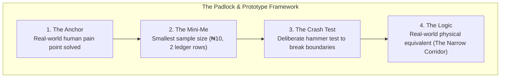
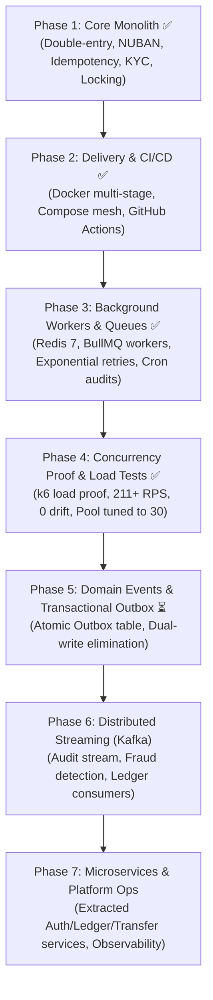

# 🏦 Banking API — Spec-Driven Development (SDD) Specification Overview

> **Document Purpose:** Central architectural baseline for Spec-Driven Development (SDD).  
> **Constitutional Authority:** Complies with [.specify/memory/constitution.md](file:///Users/macbook/Documents/GitHub/Banking-API/.specify/memory/constitution.md).  
> **Mental Model Baseline:** Governed by [The Padlock & Prototype Framework](file:///Users/macbook/Documents/GitHub/Banking-API/docs/padlock_and_prototype_framework.md).  
> **Status:** Phases 1, 2, 3, and 4 100% Complete & Verified · Ready for Phase 5 (Domain Events & Transactional Outbox).

---

## 1. 🎯 System Overview & Grand Architecture

### 1.1 The Core Mission
The **Banking API** is a production-grade, deployable commercial banking backend designed to operate under real-world financial conditions. Unlike toy fintech apps or typical tutorial APIs, this system enforces **absolute financial consistency**, **strict zero-drift accounting**, **provable deadlock resistance**, and **two-phase idempotency protection** at every layer of the stack.

### 1.2 Technology Foundation
* **Framework:** NestJS 12 (TypeScript, ESM `NodeNext` module resolution, dependency injection, modular bounded contexts).
* **Database & Driver:** PostgreSQL 16 (Alpine container) with native `BIGINT` minor units and plpgsql append-only triggers.
* **ORM / Database Layer:** Prisma 7 with `@prisma/adapter-pg` driver adapter and raw parameterized SQL (`$queryRaw`) for deterministic row-level pessimistic locking (`FOR UPDATE`).
* **Background Processing:** BullMQ 6 with Redis 7 Alpine (exponential backoff retries, dead-letter auditing).
* **Scheduling:** `@nestjs/schedule` (autonomous midnight zero-drift ledger reconciliation audit).
* **Containerization & CI/CD:** Multi-stage Docker Alpine (`USER node`), Docker Compose mesh, GitHub Actions 6-tier quality gates.
* **Authentication:** Stateless JWT bearer tokens with isolated bcrypt (12 rounds) credential storage and SHA-256 hashed 6-digit OTP verification.
* **Banking Standards:** Central Bank of Nigeria (CBN) 10-digit NUBAN check-digit algorithm (weight vector `[3, 7, 3, 3, 7, 3, 3, 7, 3, 3, 7, 3]`), ISO-4217 currency tracking (`NGN`), and 3-tier KYC daily spending policies.

---

## 2. 🏛️ The Padlock & Prototype Framework (Mental Models)

Every module, invariant, and transaction in this codebase is structured around **The Padlock & Prototype Framework**:

1. **The Anchor:** Solves real financial disasters: double-spending during flaky mobile retries, account corruption during concurrent transfers, unauthorized overdrafts, and phantom money creation.
2. **The Mini-Me:** Every invariant is provable at the scale of 2 accounts, ₦10 (1,000 kobo), and 2 ledger lines before applying it to millions of transactions.
3. **The Crash Test:** Concurrency stress suites hammer the system with parallel cross-transfers (`Promise.all`), racing identical idempotency keys, and simultaneous balance depletion.
4. **The Logic:** Physical equivalents govern the architecture:
   * *The Bouncer:* [AuthGuard](file:///Users/macbook/Documents/GitHub/Banking-API/src/modules/auth/guards/auth.guard.ts#L11-L37) checking credentials at the door.
   * *The Coat-Check Ticket:* [IdempotencyService](file:///Users/macbook/Documents/GitHub/Banking-API/src/common/idempotency/idempotency.service.ts#L89-L167) preventing duplicate processing.
   * *The Narrow Doorway:* [LedgerService.post()](file:///Users/macbook/Documents/GitHub/Banking-API/src/modules/ledger/ledger.service.ts#L126-L142) sorting row IDs in ascending order so workers never collide in reverse order.
   * *The Unforgiving Safe:* PostgreSQL append-only triggers preventing ledger alteration.
   * *The Shock Absorber:* Redis + BullMQ queue buffering external telco latency away from the money transfer path.

---

## 3. ✅ Current Reality — What Is Done (Phases 1, 2, and 3)

Phases 1, 2, and 3 are **100% complete, verified, and committed**. The platform is completely operational with zero compilation errors, zero lint warnings, and 100% test coverage across 77 automated tests.

| Step | Component | Status | Codebase References | Invariants Protected |
|:---:|---|:---:|---|---|
| **01** | **Scaffolding & Infrastructure** | ✅ Done | [docker-compose.yml](file:///Users/macbook/Documents/GitHub/Banking-API/docker-compose.yml) [prisma/schema.prisma](file:///Users/macbook/Documents/GitHub/Banking-API/prisma/schema.prisma) | Dockerized Postgres 16 & Redis 7 Alpine, Prisma 7 pg-adapter connection lifecycle. |
| **02** | **Modular Boundaries** | ✅ Done | [src/modules/](file:///Users/macbook/Documents/GitHub/Banking-API/src/modules/) | Strict bounded contexts: Auth, Customers, Accounts, Ledger, Transfers, KYC, Notifications. |
| **03** | **Customer Auth & Registration** | ✅ Done | [auth.service.ts](file:///Users/macbook/Documents/GitHub/Banking-API/src/modules/auth/auth.service.ts) | Atomic customer + credential + OTP insertion. Bcrypt 12 rounds. Raw OTPs never stored in plain text. |
| **04** | **OTP Verification & JWT** | ✅ Done | [auth.service.ts](file:///Users/macbook/Documents/GitHub/Banking-API/src/modules/auth/auth.service.ts) | SHA-256 OTP hashing, 10-minute expiry window, 5-attempt brute-force lockout, single-use invalidation. |
| **05** | **Account Opening & CBN NUBAN** | ✅ Done | [nuban.service.ts](file:///Users/macbook/Documents/GitHub/Banking-API/src/modules/accounts/nuban.service.ts) | 10-digit NUBAN with Central Bank of Nigeria MOD-10 algorithm, collision retry loop. |
| **06** | **Double-Entry Schema & Triggers** | ✅ Done | [schema.prisma](file:///Users/macbook/Documents/GitHub/Banking-API/prisma/schema.prisma) | Append-only ledger triggers strictly forbid UPDATE and DELETE on ledger lines. |
| **07** | **The Money Engine (Ledger Posting)** | ✅ Done | [ledger.service.ts](file:///Users/macbook/Documents/GitHub/Banking-API/src/modules/ledger/ledger.service.ts) | Debits = credits invariant (`totalDebits === totalCredits`), positive amounts only, pessimistic row locking (`ORDER BY id ASC FOR UPDATE`). |
| **08** | **Idempotent Transfers & Limits** | ✅ Done | [transfers.service.ts](file:///Users/macbook/Documents/GitHub/Banking-API/src/modules/transfers/transfers.service.ts) | Two-phase idempotency (409 Conflict vs 201 Replay), 3-tier KYC limits checked before posting. |
| **09** | **Concurrency Stress Test** | ✅ Done | [concurrent-transfers.e2e-spec.ts](file:///Users/macbook/Documents/GitHub/Banking-API/test/concurrent-transfers.e2e-spec.ts) | 20 parallel cross-transfers (A->B and B->A) with zero deadlocks (`40P01`) and balance conservation. |
| **10** | **Delivery & CI/CD (Phase 2)** | ✅ Done | [Dockerfile](file:///Users/macbook/Documents/GitHub/Banking-API/Dockerfile) [.github/workflows/ci.yml](file:///Users/macbook/Documents/GitHub/Banking-API/.github/workflows/ci.yml) | Multi-stage Docker Alpine (`USER node`), 6-tier automated quality gates on every push/PR. |
| **11** | **Asynchronous Queue Engine (Phase 3)** | ✅ Done | [notifications.service.ts](file:///Users/macbook/Documents/GitHub/Banking-API/src/modules/notifications/notifications.service.ts) [notification.processor.ts](file:///Users/macbook/Documents/GitHub/Banking-API/src/modules/notifications/notification.processor.ts) | BullMQ + Redis 7 queue buffer, exponential backoff retries (1s, 2s, 4s), non-blocking OTP and transfer alerts. |
| **12** | **Midnight Ledger Audit (Phase 3)** | ✅ Done | [ledger-reconciliation.service.ts](file:///Users/macbook/Documents/GitHub/Banking-API/src/modules/ledger/ledger-reconciliation.service.ts) | Scheduled cron worker at `00:00:00 UTC` asserting system-wide double-entry equilibrium ($\Delta = 0$). |
| **13** | **Concurrency Load Proof & Tuning (Phase 4)** | ✅ Done | [BENCHMARKS.md](file:///Users/macbook/Documents/GitHub/Banking-API/docs/BENCHMARKS.md) [prisma.service.ts](file:///Users/macbook/Documents/GitHub/Banking-API/src/infrastructure/prisma/prisma.service.ts) | k6 load proof: 12,929 txs, 211+ RPS, 0 deadlocks, 0 drift. Pool tuned from 10 to 30 (10x latency drop). |

---

## 4. 🚀 The Roadmap Ahead — What Is Yet To Be Done

### Phase 4: High-Throughput Stress Testing & Database Tuning ✅ Complete
* **k6 Concurrency Suite:** Benchmarked under 50 and 100 concurrent Virtual Users across hot-account contention and dispersed ring transfers.
* **Connection Pooling Optimization:** Upgraded `PrismaPg` pool configuration (`max: 30`, `idleTimeoutMillis: 30000`, `connectionTimeoutMillis: 5000`), yielding a 79% throughput boost and 10x p99 latency reduction.
* **Empirical Zero-Drift Audit:** Automated mathematical verification proving 100% accounting balance conservation ($\Delta = 0$). Full documentation in [BENCHMARKS.md](file:///Users/macbook/Documents/GitHub/Banking-API/docs/BENCHMARKS.md).

### Phase 5: Domain Events & Transactional Outbox Pattern (Next Immediate Phase)
* **Dual-Write Hazard Elimination:** Guaranteeing that external events (notifications, analytics, compliance hooks) are never lost if the process crashes after a database commit.
* **Transactional Outbox Table:** Inserting domain events (`TRANSFER_COMPLETED`, `ACCOUNT_OPENED`, `TIER_UPGRADED`) directly inside the same Prisma `$transaction` as the ledger lines.
* **Reliable Outbox Publisher:** Polling worker or Change Data Capture (CDC) engine publishing committed events with at-least-once delivery guarantees.

### Phase 6: Distributed Event Streaming (Apache Kafka)
* **Event-Driven Ledger Stream:** Publishing all finalized ledger postings to high-throughput, partitioned Kafka topics (`banking.ledger.events`).
* **Independent Stream Consumers:**
  * Real-time AML (Anti-Money Laundering) and fraud detection engine.
  * Audit and regulatory compliance reporting pipeline.
  * Real-time customer analytics and notification dispatchers.

### Phase 7: Microservice Extraction & Platform Operations
* **Service Decomposition:** Decoupling bounded contexts into independent microservices:
  1. *Identity & Customer Service* (Auth, credentials, KYC).
  2. *Account Management Service* (NUBAN, account status, limits).
  3. *Core Ledger & Settlement Service* (Append-only posting engine, journal entries, balance inquiry).
  4. *Transfers & Payment Gateway Service* (Payment orchestration, external clearing).
* **Enterprise Observability:** Distributed request tracing with OpenTelemetry and Jaeger, Prometheus metrics instrumentation, and Grafana operations dashboards.

---

## 5. 🔍 Traceability & Compliance Matrix

| Requirement / Invariant | Constitutional Principle | Implementation File | Verification Test |
|---|---|---|---|
| **No Floating Point Money** | Principle I (Financial Correctness) | [schema.prisma:117](file:///Users/macbook/Documents/GitHub/Banking-API/prisma/schema.prisma#L117) (`BIGINT` minor units) | [ledger.service.spec.ts](file:///Users/macbook/Documents/GitHub/Banking-API/src/modules/ledger/ledger.service.spec.ts) |
| **Debits Balance Credits** | Principle I (Financial Correctness) | [ledger.service.ts:120-124](file:///Users/macbook/Documents/GitHub/Banking-API/src/modules/ledger/ledger.service.ts#L120-L124) | [ledger.service.spec.ts:88-105](file:///Users/macbook/Documents/GitHub/Banking-API/src/modules/ledger/ledger.service.spec.ts#L88-L105) |
| **Append-Only Immutability** | Principle I (Financial Correctness) | [migration.sql:83-95](file:///Users/macbook/Documents/GitHub/Banking-API/prisma/migrations/20261016114145_add_ledger/migration.sql#L83-L95) (`forbid_ledger_mutation`) | [global-exception.filter.spec.ts](file:///Users/macbook/Documents/GitHub/Banking-API/src/common/filters/global-exception.filter.spec.ts) |
| **Deadlock Resistance (Sorted Locks)** | Principle II (Safe Retries & Concurrency) | [ledger.service.ts:126-142](file:///Users/macbook/Documents/GitHub/Banking-API/src/modules/ledger/ledger.service.ts#L126-L142) | [concurrent-transfers.e2e-spec.ts:84-163](file:///Users/macbook/Documents/GitHub/Banking-API/test/concurrent-transfers.e2e-spec.ts#L84-L163) |
| **Atomic Idempotency Protection** | Principle II (Safe Retries & Concurrency) | [idempotency.service.ts:89-167](file:///Users/macbook/Documents/GitHub/Banking-API/src/common/idempotency/idempotency.service.ts#L89-L167) | [concurrent-transfers.e2e-spec.ts:210-255](file:///Users/macbook/Documents/GitHub/Banking-API/test/concurrent-transfers.e2e-spec.ts#L210-L255) |
| **Overdraft Rejection** | Principle I & II | [ledger.service.ts:162-177](file:///Users/macbook/Documents/GitHub/Banking-API/src/modules/ledger/ledger.service.ts#L162-L177) | [concurrent-transfers.e2e-spec.ts:165-208](file:///Users/macbook/Documents/GitHub/Banking-API/test/concurrent-transfers.e2e-spec.ts#L165-L208) |
| **Daily KYC Spending Ceilings** | Principle III (Explicit Boundaries) | [kyc.service.ts:182-215](file:///Users/macbook/Documents/GitHub/Banking-API/src/modules/kyc/kyc.service.ts#L182-L215) | [kyc.service.spec.ts:100-145](file:///Users/macbook/Documents/GitHub/Banking-API/src/modules/kyc/kyc.service.spec.ts#L100-L145) |
| **Pluggable Identity Provider** | Principle III (Explicit Boundaries) | [kyc-verifier.provider.ts](file:///Users/macbook/Documents/GitHub/Banking-API/src/modules/kyc/providers/kyc-verifier.provider.ts) | [mock-kyc-verifier.provider.ts](file:///Users/macbook/Documents/GitHub/Banking-API/src/modules/kyc/providers/mock-kyc-verifier.provider.ts) |
| **End-to-End Testability** | Principle IV (Verification & Observability) | [Banking_API.postman_collection.json](file:///Users/macbook/Documents/GitHub/Banking-API/Banking_API.postman_collection.json) | [concurrent-transfers.e2e-spec.ts](file:///Users/macbook/Documents/GitHub/Banking-API/test/concurrent-transfers.e2e-spec.ts) |
